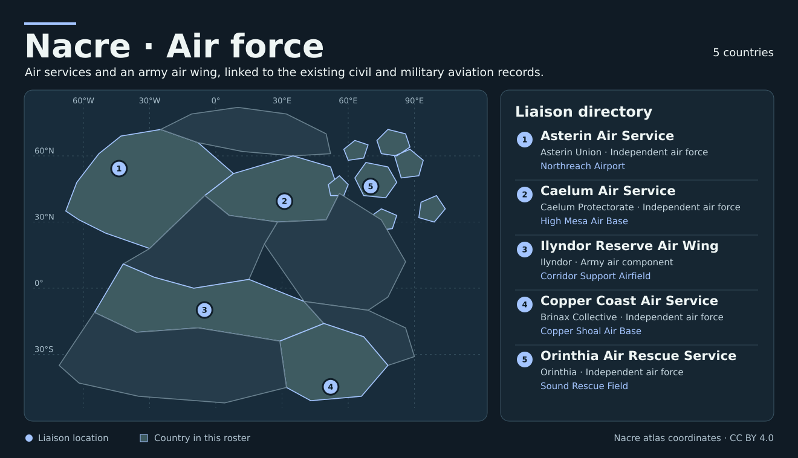

# Nacre air force

Five countries have an air service or an air component. This roster identifies the organizations and liaison desks behind airlift and rescue coordination. The military aviation extension supplies the airfields and aircraft, and civil aviation supplies the civil airports and controllers.

## Country roster

| Country | Service | Organization | Liaison site | Exercise role |
|---|---|---|---|---|
| Asterin Union | Asterin Air Service | Independent air force | Northreach Airport | Maintains airlift and rescue liaison with northern civilian aviation. |
| Caelum Protectorate | Caelum Air Service | Independent air force | High Mesa Air Base | Coordinates airlift staging and shared-airspace requests for the plateau. |
| Ilyndor | Ilyndor Reserve Air Wing | Army air component | Corridor Support Airfield | Coordinates civil support flights for the territorial reserve. |
| Brinax Collective | Copper Coast Air Service | Independent air force | Copper Shoal Air Base | Coordinates airlift dispatch and civil reporting for the southern coast. |
| Orinthia | Orinthia Air Rescue Service | Independent air force | Sound Rescue Field | Coordinates island rescue aviation and arrival status with the civil airport. |

Liaison points inherit the coordinates of their named hosts on the shared fictional grid. Highlighted countries have a service represented in this roster. [Nacre geographic atlas](../../geography/README.md)

The [space force roster](../space-force/README.md) links Caelum’s space component to Caelum Air Service.

## Exercise case · Confirm a relief arrival at Sound

Brinax is preparing an emergency relief flight. Sound Rescue Field can accept the proposed arrival, but Sound Airport is still confirming local handling arrangements. The civil controllers request a single update that separates the receiving field's status from civil coordination.

**Participant task.** Identify the dispatch liaison, the receiving liaison, and their civil contacts. Record the confirmations in one movement note and decide when the status can move from proposed to confirmed.

**Facilitator check.** Copper Coast Air Service checks departure readiness with Copper Shoal and the civil side with Coastal Control. Orinthia Air Rescue Service confirms receiving readiness with Sound Rescue Field and obtains the liaison update from Sound Airport. Keep the proposed movement pending until the required confirmations are recorded.

## MISP Galaxy

Load the base Synthetic Exercise World and the linked records from [army](../army/README.md#misp-galaxy), [civil aviation](../aviation/README.md#misp-galaxy), and [military aviation](../military-aviation/README.md#misp-galaxy). Import the [Galaxy definition](galaxies/exercise-world-air-force.json) and [cluster collection](clusters/exercise-world-air-force.json) under type `exercise-world-air-force`.

| Relationship | Meaning |
|---|---|
| `located-in` | References the service’s country in the base Galaxy. |
| `has-liaison-at` | References an existing host facility. The liaison point uses the host’s coordinates. |
| `coordinates-with` | References a civil or defense partner for the exercise role. |
| `part-of` | Identifies the parent service for a named component. |

The geographic feature ID matches the service cluster UUID. Base country references use the pinned [MISP Galaxy revision `779b780`](https://github.com/MISP/misp-galaxy/blob/779b780a13f67288d9b1a031b064fb140cdacaae/clusters/exercise-world.json).

The map adapts Nacre’s geography under CC BY 4.0. [Original atlas](../../images/synthetic_exercise_world_clear_map.svg) · [License](../../LICENSE)
