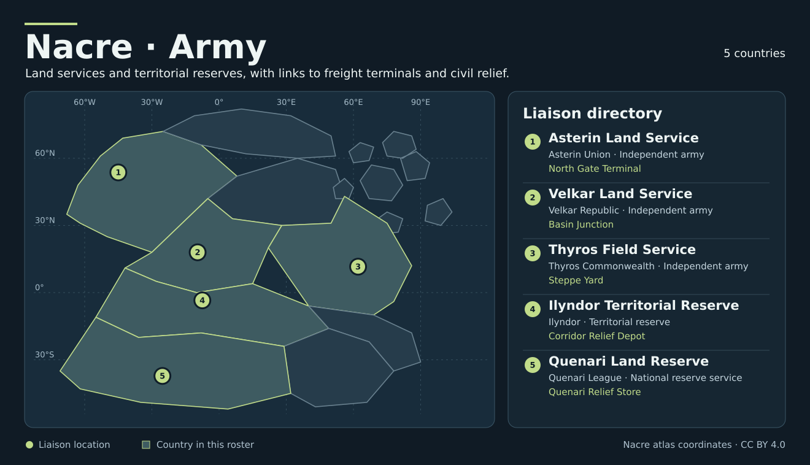

# Nacre army

Five Nacre countries maintain an army or a territorial reserve in this roster. Their public liaison teams coordinate overland logistics, engineering support, and requests from civil authorities. Ilyndor and Quenari use reserve services in the exercise baseline.

## Country roster

| Country | Service | Organization | Liaison site | Exercise role |
|---|---|---|---|---|
| Asterin Union | Asterin Land Service | Independent army | North Gate Terminal | Coordinates engineering support requests and tracks relief freight leaving the northern terminal. |
| Velkar Republic | Velkar Land Service | Independent army | Basin Junction | Coordinates heavy freight documentation and handoffs between rail and road carriers. |
| Thyros Commonwealth | Thyros Field Service | Independent army | Steppe Yard | Coordinates road-clearance requests and civil freight staging in the steppe. |
| Ilyndor | Ilyndor Territorial Reserve | Territorial reserve | Corridor Relief Depot | Receives requests for civil engineering support and coordinates cross-border relief handoffs. |
| Quenari League | Quenari Land Reserve | National reserve service | Quenari Relief Store | Reconciles emergency stores and connects district requests to civilian relief dispatch. |

Liaison points inherit the coordinates of their named hosts on the shared fictional grid. Highlighted countries have a service represented in this roster. [Nacre geographic atlas](../../geography/README.md)

The [air force roster](../air-force/README.md) includes the Ilyndor Reserve Air Wing, which is part of the Ilyndor Territorial Reserve.

## Exercise case · Supplies at Basin Junction

A flood closes the road used to dispatch a relief consignment from Basin Junction. The Basin Main Line still connects the junction to Corridor Interchange. Corridor Relief Depot agrees to receive the consignment, and the Ilyndor Territorial Reserve can arrange the last handoff once the depot confirms availability.

**Participant task.** Assign a reporting lead at Basin Junction, request a receiving contact in Ilyndor, and prepare a handoff record with the consignment ID, quantity, and current custodian.

**Facilitator check.** The Velkar Land Service handles the origin report. The Ilyndor Territorial Reserve confirms the receiving plan with Corridor Relief Depot. Keep the original consignment ID across the rail and road handoffs, and mark delivery complete when the depot acknowledges it.

## MISP Galaxy

Load the base Synthetic Exercise World and the linked records from [transport and logistics](../transport/README.md#misp-galaxy) and [civil and humanitarian services](../civil-humanitarian/README.md#misp-galaxy). Import the [Galaxy definition](galaxies/exercise-world-army.json) and [cluster collection](clusters/exercise-world-army.json) under type `exercise-world-army`.

| Relationship | Meaning |
|---|---|
| `located-in` | References the service’s country in the base Galaxy. |
| `has-liaison-at` | References an existing host facility. The liaison point uses the host’s coordinates. |
| `coordinates-with` | References a civil or defense partner for the exercise role. |

The geographic feature ID matches the service cluster UUID. Base country references use the pinned [MISP Galaxy revision `779b780`](https://github.com/MISP/misp-galaxy/blob/779b780a13f67288d9b1a031b064fb140cdacaae/clusters/exercise-world.json).

The map adapts Nacre’s geography under CC BY 4.0. [Original atlas](../../images/synthetic_exercise_world_clear_map.svg) · [License](../../LICENSE)
