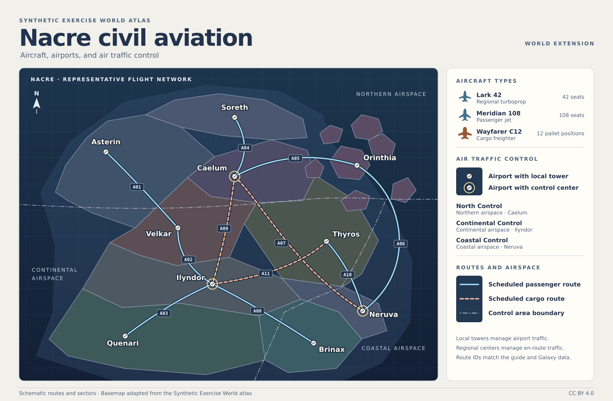

# Nacre civil aviation

This extension adds civilian aircraft types, towered airports in all ten Nacre countries, regional air traffic control centers, and representative passenger and cargo services.

The editable SVG separates the basemap, airspace, passenger routes, cargo routes, and airports into layers. A ring marks an airport that also hosts a regional control center. Route IDs match the guide and Galaxy records. Routes and airspace boundaries are schematic.

## Aircraft

| Type | Role | Exercise capacity |
|---|---|---:|
| Lark 42 | Regional passenger turboprop | 42 seats |
| Meridian 108 | Passenger jet | 108 seats |
| Wayfarer C12 | Cargo freighter | 12 pallet positions |

## Airports and air traffic controllers

Local towers coordinate arrivals, departures, and movements at their airports. Regional en-route controllers manage flights in their control areas and coordinate handoffs across area boundaries. Airport operators confirm which aircraft the field can receive and what handling capacity is available.

| Control area | En-route center | Host airport |
|---|---|---|
| Northern airspace | North Control | Plateau Airport |
| Continental airspace | Continental Control | Corridor Airport |
| Coastal airspace | Coastal Control | Delta Gateway |

| Country | Airport | Local tower | En-route center | Aircraft accepted |
|---|---|---|---|---|
| Asterin Union | Northreach Airport | Asterin Tower | North Control | Lark 42 |
| Velkar Republic | Basin Airport | Velkar Tower | Continental Control | Lark 42, Meridian 108 |
| Caelum Protectorate | Plateau Airport | Caelum Tower | North Control | Lark 42, Wayfarer C12 |
| Orinthia | Sound Airport | Orinthia Tower | North Control | Lark 42, Meridian 108 |
| Thyros Commonwealth | Steppe Airport | Thyros Tower | Continental Control | Lark 42, Wayfarer C12 |
| Ilyndor | Corridor Airport | Ilyndor Tower | Continental Control | Lark 42, Meridian 108, Wayfarer C12 |
| Neruva Federation | Delta Gateway | Neruva Tower | Coastal Control | Lark 42, Meridian 108, Wayfarer C12 |
| Brinax Collective | Coast Airport | Brinax Tower | Coastal Control | Meridian 108 |
| Quenari League | Equator Airport | Quenari Tower | Continental Control | Lark 42 |
| Soreth Dominion | Tundra Airfield | Soreth Tower | North Control | Lark 42 |

## Scheduled routes

The listed services run in both directions in the exercise baseline.

| Route | Airports | Aircraft | Service |
|---|---|---|---|
| A01 · Northreach Shuttle | Northreach Airport ↔ Basin Airport | Lark 42 | Passengers |
| A02 · Basin Connector | Basin Airport ↔ Corridor Airport | Meridian 108 | Passengers |
| A03 · Equator Shuttle | Corridor Airport ↔ Equator Airport | Lark 42 | Passengers |
| A04 · Tundra Shuttle | Plateau Airport ↔ Tundra Airfield | Lark 42 | Passengers |
| A05 · Sound Shuttle | Plateau Airport ↔ Sound Airport | Lark 42 | Passengers |
| A06 · Azure Passenger Link | Sound Airport ↔ Delta Gateway | Meridian 108 | Passengers |
| A07 · Plateau Cargo Link | Plateau Airport ↔ Delta Gateway | Wayfarer C12 | Cargo |
| A08 · Coast Express | Corridor Airport ↔ Coast Airport | Meridian 108 | Passengers |
| A09 · Corridor Cargo Link | Plateau Airport ↔ Corridor Airport | Wayfarer C12 | Cargo |
| A10 · Steppe Shuttle | Steppe Airport ↔ Delta Gateway | Lark 42 | Passengers |
| A11 · Steppe Cargo Link | Steppe Airport ↔ Corridor Airport | Wayfarer C12 | Cargo |

## Exercise case · Arrivals paused at Delta Gateway

A storm pauses arrivals at Delta Gateway for 90 minutes. Coastal Control remains in service. The exercise starts with the A06 passenger flight airborne from Sound Airport with 94 passengers. A07 is still on the ground at Plateau Airport with 10 pallets awaiting dispatch.

Coast Airport confirms it can receive the Meridian 108 and handle up to 100 arriving passengers during the exercise window. An available Wayfarer C12 can carry freight on A09, and Corridor Airport can handle eight pallets in the same window.

**Participant task.** Coordinate a diversion for A06 and decide how much A07 freight to rebook. Identify the en-route centers, local towers, and airport operators involved, then draft a shared update for passengers, cargo handlers, and onward transport staff.

**Facilitator check.** Divert A06 to Coast Airport in Brinax. North Control coordinates the handoff to Coastal Control, and Brinax Tower and the airport operator coordinate the local arrival and reception of all 94 passengers. Rebook eight pallets on A09 to Corridor Airport and retain two at Plateau Airport. The freighter has 12 positions, and Corridor Airport's eight-pallet handling limit determines how much can move. North Control and Continental Control coordinate the A09 handoff, with Caelum and Ilyndor towers handling their respective departures and arrivals.

## MISP Galaxy

Load the base Synthetic Exercise World galaxy and cluster collection first, then import the aviation [Galaxy definition](galaxies/exercise-world-aviation.json) and [cluster collection](clusters/exercise-world-aviation.json). Use galaxy type `exercise-world-aviation`.

| `meta.entity-type` | Metadata and relationships |
|---|---|
| `aircraft-type` | `airframe`, `service`, `capacity`, and `capacity-unit` describe the aircraft. Each type links to its routes with `used-on`. |
| `airport` | `airport-id` is a fictional identifier with the `NAC-` prefix. Each airport is `located-in` a base country by UUID, `served-by` its tower, and `within-control-area` of its regional center. `accepts-aircraft` records which types it can receive. |
| `air-traffic-control-unit` | `control-role` identifies a local tower or an en-route center. Towers link to the airport they serve. Centers link to their host airport, the airports in their `airspace`, and the corresponding towers. |
| `scheduled-air-route` | `route-id` matches the map, and `service` identifies passengers or cargo. The route `uses-type` to reference an aircraft and is `terminated-by` two airports. Airports link back with `terminates`. |

To match an aircraft to a route or a diversion airport, follow the aircraft UUID and check the airport's `accepts-aircraft` relationships. The exercise states temporary availability and ground handling limits separately.

The country UUIDs were verified against [MISP Galaxy revision `779b780`](https://github.com/MISP/misp-galaxy/blob/779b780a13f67288d9b1a031b064fb140cdacaae/clusters/exercise-world.json).

The map uses recolored country outlines from the Synthetic Exercise World atlas and adds the aviation layers. The extension is licensed under CC BY 4.0. [Original atlas](../../images/synthetic_exercise_world_clear_map.svg) · [License](../../LICENSE)
