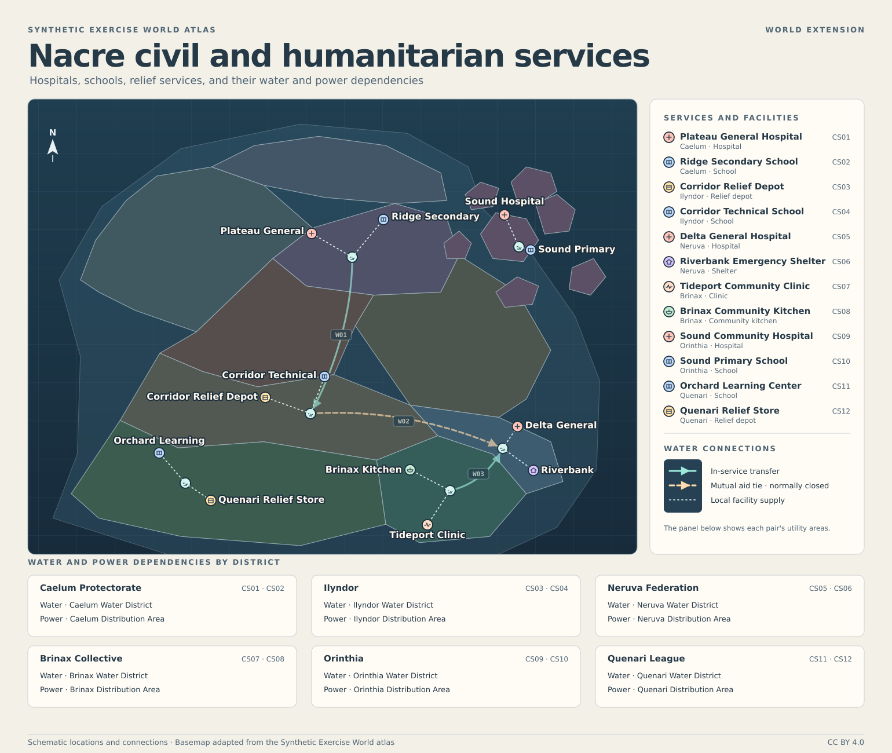

# Nacre civil and humanitarian services

This extension adds 12 representative hospitals, schools, clinics, shelters, relief depots, and community facilities across six Nacre countries. Each facility links to the local [water supply](../water-supply/README.md), [electricity](../electricity/README.md), and [telecommunications](../telecom/README.md) records. Relief facilities also reference [transport](../transport/README.md) terminals where they receive or dispatch supplies.

The editable SVG has separate layers for facilities, water districts and transfers, and the utility directory. The dotted lines show which district supplies water to each facility. The utility directory identifies the shared water and power dependencies for each pair of facilities.

## Facilities

| ID | Facility | Country | Main service |
|---|---|---|---|
| CS01 | Plateau General Hospital | Caelum Protectorate | Inpatient hospital and emergency care |
| CS02 | Ridge Secondary School | Caelum Protectorate | Secondary education and a family assistance desk during emergencies |
| CS03 | Corridor Relief Depot | Ilyndor | Regional storage and dispatch of relief supplies |
| CS04 | Corridor Technical School | Ilyndor | Technical education and designated overflow reception |
| CS05 | Delta General Hospital | Neruva Federation | Inpatient hospital and emergency care |
| CS06 | Riverbank Emergency Shelter | Neruva Federation | Temporary reception, drinking water, and family support |
| CS07 | Tideport Community Clinic | Brinax Collective | Outpatient care and referrals |
| CS08 | Brinax Community Kitchen | Brinax Collective | Meal preparation and distribution for relief operations |
| CS09 | Sound Community Hospital | Orinthia | Inpatient and island emergency care |
| CS10 | Sound Primary School | Orinthia | Primary education and a family reunification point |
| CS11 | Orchard Learning Center | Quenari League | Primary education and community learning |
| CS12 | Quenari Relief Store | Quenari League | Local staging of water and essential supplies |

## Water, electricity, and communications

| Facilities | Water district | Electricity distribution | Telecom provider |
|---|---|---|---|
| CS01, CS02 | Caelum Water District | Caelum Distribution Area | BlueBridge Networks |
| CS03, CS04 | Ilyndor Water District | Ilyndor Distribution Area | Corridor Exchange |
| CS05, CS06 | Neruva Water District | Neruva Distribution Area | DeltaReach |
| CS07, CS08 | Brinax Water District | Brinax Distribution Area | Tidegrid Fiber |
| CS09, CS10 | Orinthia Water District | Orinthia Distribution Area | Pelagic Radio |
| CS11, CS12 | Quenari Water District | Quenari Distribution Area | Equator Air |

The linked distribution areas are shared upstream dependencies. A local feeder incident can affect one building or treatment plant while other customers in the area remain in service. For exercise decisions, check the affected feeder and the status of upstream supply.

## Humanitarian logistics

| Facility | Transport handoff |
|---|---|
| Corridor Relief Depot | Corridor Interchange |
| Riverbank Emergency Shelter | Delta Port |
| Brinax Community Kitchen | Coast Terminal |
| Quenari Relief Store | Orchard Market Terminal |

The Corridor–Delta Relief Supply Arrangement links the depot and shelter through the Corridor–Delta Railway (R02). It moves packaged drinking water and essential supplies through the two listed terminals. This relief shipment and the treated-water transfer W02 use separate routes and approvals.

## Exercise case · Keep the hospital and shelter supplied

Use the same Delta Waterworks interruption as the [water supply exercise](../water-supply/README.md#exercise-case--delta-waterworks-loses-power). The hospital and shelter still have electricity and local telecom service. Together they account for Neruva's 36 priority water units in this window. Delta General Hospital needs 22 units and Riverbank Emergency Shelter needs 14.

Brinax is delivering 26 units of treated water over W03. The W02 mutual-aid tie is still awaiting confirmation. The Corridor Relief Depot has packaged drinking water equivalent to 10 units of the shelter's allocation, with space available on R02. For the exercise, the shipment can arrive within the allocation window.

**Participant task.** Allocate the 26 units, decide whether to send packaged water by rail, and inform the hospital, shelter, water utility, and electricity provider. Update the allocation once W02 begins delivering 14 units. Track packaged stock and piped supply separately.

**Facilitator check.** Assign 22 units of piped water to the hospital and four to the shelter. Send 10 units of packaged stock from the depot through Corridor Interchange and Delta Port to cover the shelter's gap. Once W02 is operating, 40 units of piped supply cover both facilities and leave four for other demand. Reassess further shipments and confirm the facilities' own utility service before changing their continuity arrangements.

## MISP Galaxy

Load the base world and the [water supply](../water-supply/README.md#misp-galaxy), [electricity](../electricity/README.md#misp-galaxy), [telecom](../telecom/README.md#misp-galaxy), and [transport](../transport/README.md#misp-galaxy) Galaxy files. Then import the [Galaxy definition](galaxies/exercise-world-civil-humanitarian.json) and [cluster collection](clusters/exercise-world-civil-humanitarian.json) for galaxy type `exercise-world-civil-humanitarian`.

| `meta.entity-type` | Relationships |
|---|---|
| `civil-humanitarian-facility` | `located-in` points to a base country. `receives-water-from`, `draws-power-from`, and `uses-telecom-provider` point to the respective utility records. `stages-supplies-via` links a relief facility to its transport terminal. |
| `humanitarian-support-arrangement` | `dispatches-from` and `delivers-to` connect the relief facilities. `uses-transport-route` identifies the transport leg. |

The map adapts the Nacre atlas and the water supply overlay under CC BY 4.0. [Original atlas](../../images/synthetic_exercise_world_clear_map.svg) · [Water supply map](../water-supply/water-supply-map.svg) · [License](../../LICENSE)
