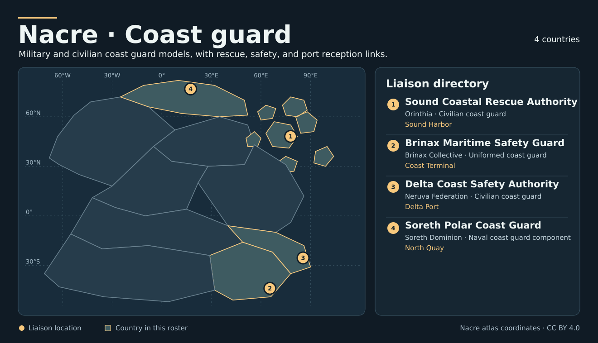

# Nacre coast guard

Four coastal and island countries have a coast guard entry. Orinthia and Neruva use civilian authorities, Brinax has a uniformed maritime safety service, and Soreth assigns the coast guard role to a naval component. Their shared responsibilities include rescue liaison, safety notices, and passenger reception.

## Country roster

| Country | Service | Organization | Liaison site | Exercise role |
|---|---|---|---|---|
| Orinthia | Sound Coastal Rescue Authority | Civilian coast guard | Sound Harbor | Coordinates ferry rescue notifications and island passenger reception. |
| Brinax Collective | Brinax Maritime Safety Guard | Uniformed coast guard | Coast Terminal | Coordinates safety notices, port reception, and clinic liaison. |
| Neruva Federation | Delta Coast Safety Authority | Civilian coast guard | Delta Port | Coordinates waterway closures and passenger reception in the delta. |
| Soreth Dominion | Soreth Polar Coast Guard | Naval coast guard component | North Quay | Coordinates cold-weather maritime safety and reception at the northern quay. |

Liaison points inherit the coordinates of their named hosts on the shared fictional grid. Highlighted countries have a service represented in this roster. [Nacre geographic atlas](../../geography/README.md)

## Exercise case · A rescue reception changes ports

A ferry reports that it needs assistance. Sound Harbor is initially named as the passenger reception point, but the berth becomes unavailable. Coast Terminal confirms a receiving berth, and Tideport Community Clinic asks for the latest reception status.

**Participant task.** Agree which team updates the rescue incident record, which team confirms the receiving arrangements, and what should appear in the shared passenger reception notice.

**Facilitator check.** Sound Coastal Rescue Authority retains the incident reference and shares the change with Brinax Maritime Safety Guard. Brinax confirms the berth with Coast Terminal and updates the clinic liaison. Both teams use the same incident reference and record which authority is coordinating reception.

## MISP Galaxy

Load the base Synthetic Exercise World and the linked records from [navy](../navy/README.md#misp-galaxy), [transport and logistics](../transport/README.md#misp-galaxy), and [civil and humanitarian services](../civil-humanitarian/README.md#misp-galaxy). Import the [Galaxy definition](galaxies/exercise-world-coast-guard.json) and [cluster collection](clusters/exercise-world-coast-guard.json) under type `exercise-world-coast-guard`.

| Relationship | Meaning |
|---|---|
| `located-in` | References the service’s country in the base Galaxy. |
| `has-liaison-at` | References an existing host facility. The liaison point uses the host’s coordinates. |
| `coordinates-with` | References a civil or defense partner for the exercise role. |
| `part-of` | Identifies the parent service for a named component. |

The geographic feature ID matches the service cluster UUID. Base country references use the pinned [MISP Galaxy revision `779b780`](https://github.com/MISP/misp-galaxy/blob/779b780a13f67288d9b1a031b064fb140cdacaae/clusters/exercise-world.json).

The map adapts Nacre’s geography under CC BY 4.0. [Original atlas](../../images/synthetic_exercise_world_clear_map.svg) · [License](../../LICENSE)
