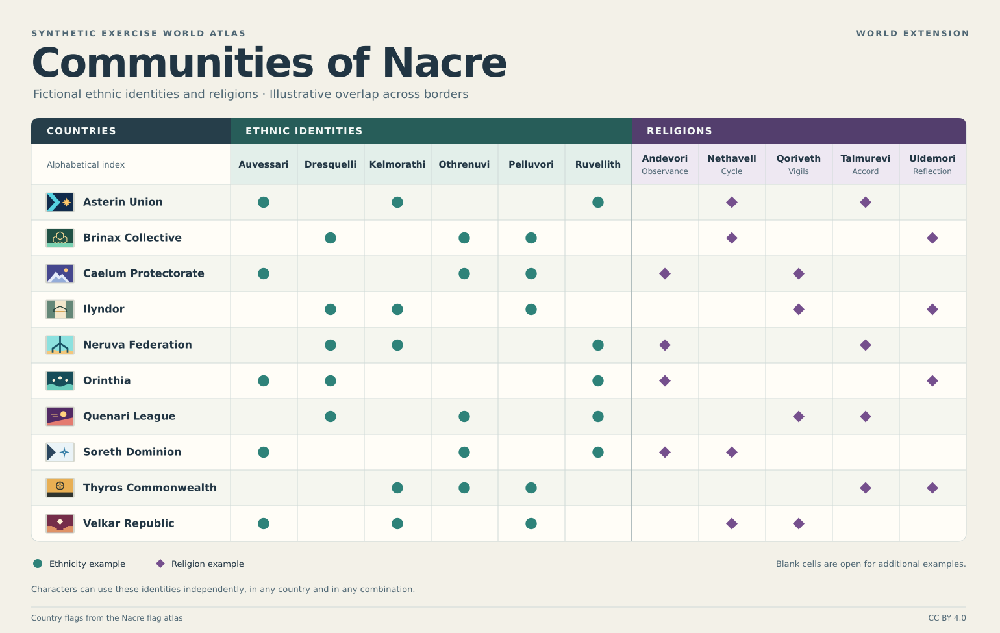

# Communities of Nacre

This extension introduces six invented ethnic identities and five invented religions for fictional characters. The examples overlap across all ten Nacre countries. Characters can use any of these identities in any country and can choose their ethnic or religious affiliations independently.

Marks in the editable SVG and entries in the table indicate sample associations. Blank cells are open for additional examples. Read the two groups independently when writing a character or an exercise.

## Community examples by country

| Country | Ethnic identity examples | Religion examples |
|---|---|---|
| Asterin Union | Auvessari, Kelmorathi, Ruvellith | Nethavell Cycle, Talmurevi Accord |
| Brinax Collective | Dresquelli, Othrenuvi, Pelluvori | Nethavell Cycle, Uldemori Reflection |
| Caelum Protectorate | Auvessari, Othrenuvi, Pelluvori | Andevori Observance, Qoriveth Vigils |
| Ilyndor | Dresquelli, Kelmorathi, Pelluvori | Qoriveth Vigils, Uldemori Reflection |
| Neruva Federation | Dresquelli, Kelmorathi, Ruvellith | Andevori Observance, Talmurevi Accord |
| Orinthia | Auvessari, Dresquelli, Ruvellith | Andevori Observance, Uldemori Reflection |
| Quenari League | Dresquelli, Othrenuvi, Ruvellith | Qoriveth Vigils, Talmurevi Accord |
| Soreth Dominion | Auvessari, Othrenuvi, Ruvellith | Andevori Observance, Nethavell Cycle |
| Thyros Commonwealth | Kelmorathi, Othrenuvi, Pelluvori | Talmurevi Accord, Uldemori Reflection |
| Velkar Republic | Auvessari, Kelmorathi, Pelluvori | Nethavell Cycle, Qoriveth Vigils |

## Invented religions

The descriptions provide optional material for scenes or character profiles.

| Religion | Example observance |
|---|---|
| Andevori Observance | An invented religion whose example gatherings include short readings chosen in turn by participants. |
| Nethavell Cycle | An invented religion with an example calendar of reflection days and community gatherings. |
| Qoriveth Vigils | An invented religion whose example observances include evening gatherings centered on listening and reflection. |
| Talmurevi Accord | An invented religion with an example observance of writing and sharing personal reflections. |
| Uldemori Reflection | An invented religion with an example practice of quiet, self-guided reflection. |

## Exercise case · Record a character's chosen affiliations

Prepare an exchange of three fictional oral-history records.

- An Orinthian character identifies as Auvessari and reports the Uldemori Reflection.
- A Soreth character also identifies as Auvessari and reports the Andevori Observance.
- An Asterin character identifies as Kelmorathi and leaves the religion field blank.

**Participant task.** Record the country UUID for each character and the community UUIDs for the labels each character supplied. Share the sample records with a second team and check that the two Auvessari entries retain their different religious affiliations and that the blank field stays blank.

## MISP Galaxy

Load the base Synthetic Exercise World Galaxy, then import the [Galaxy definition](galaxies/exercise-world-communities.json) and [cluster collection](clusters/exercise-world-communities.json). Use the Galaxy type `exercise-world-communities`.

Each cluster uses either `meta.entity-type = ["fictional-ethnicity"]` or `["fictional-religion"]`. Its `represented-in-examples-for` relationships point to existing country UUIDs and are marked `illustrative` in `meta.association-scope`. Use the relevant entity family when looking up a character's chosen label.

Country references match the base Synthetic Exercise World. [MISP Galaxy revision `779b780`](https://github.com/MISP/misp-galaxy/blob/779b780a13f67288d9b1a031b064fb140cdacaae/clusters/exercise-world.json)

The visual index reuses the country flags under CC BY 4.0. [Flag atlas](../country-flags/README.md) · [License](../../LICENSE)
