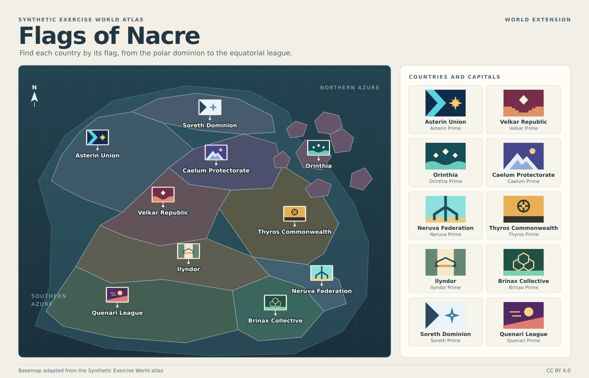
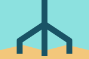

# Flags of Nacre

Ten original flags identify the ten fictional countries of Nacre. The atlas shows each flag at its country and repeats it in a visual index with the capital.

## Flag index

Select a flag to open its standalone 3:2 SVG.

| Flag | Country | Capital | Recognition cue |
|---|---|---|---|
|  | Asterin Union | Asterin Prime | A cyan chevron and gold eight-point star on midnight blue recall northern skies and the energy network. |
|  | Velkar Republic | Velkar Prime | A copper stepped basin and ivory diamond on burgundy represent the inland basin and its trade. |
|  | Orinthia | Orinthia Prime | Three ivory island diamonds above a sea-green wave represent the archipelago. |
|  | Caelum Protectorate | Caelum Prime | Two pale mountain peaks and an amber sun against indigo evoke the high plateau. |
|  | Neruva Federation | Neruva Prime | A dark river splits into three channels over a turquoise field and sand-colored delta. |
|  | Thyros Commonwealth | Thyros Prime | An ochre field bears a dark four-spoke wheel above a charcoal stripe for inland trade routes. |
|  | Ilyndor | Ilyndor Prime | Two sage fields enclose an ivory corridor and a gold bridge. |
|  | Brinax Collective | Brinax Prime | Three joined hexagonal cells above a mint coastal stripe represent a shared grid and cooperative institutions. |
|  | Soreth Dominion | Soreth Prime | An ice-white field, a navy wedge, and a blue compass rose recall polar navigation. |
|  | Quenari League | Quenari Prime | A gold sun and rising coral band on plum evoke the equatorial growing season. |

## Exercise case · Identify the reporting country

Give participants a few status cards labeled only with these flags. Ask them to match each card to a country using the atlas and record the country's name and capital. Use the index to check the answers. For data exchange, match the corresponding country UUID from the Galaxy record.

## MISP Galaxy

Load the base Synthetic Exercise World, then import the [Galaxy definition](galaxies/exercise-world-country-flags.json) and [cluster collection](clusters/exercise-world-country-flags.json). Use galaxy type `exercise-world-country-flags`. Each `country-flag` cluster uses a `represents` relationship to the existing country UUID. Resolve `meta.flag-path` from the root of the repository at the revision your exercise uses. The canonical country records use the standard `meta.refs` array for published reference URLs.

Country names, capitals, and UUIDs were verified against the original Nacre country records. [MISP Galaxy revision `779b780`](https://github.com/MISP/misp-galaxy/blob/779b780a13f67288d9b1a031b064fb140cdacaae/clusters/exercise-world.json)

The flags and atlas adaptation are licensed under CC BY 4.0. [Original atlas](../../images/synthetic_exercise_world_clear_map.svg) · [License](../../LICENSE)
