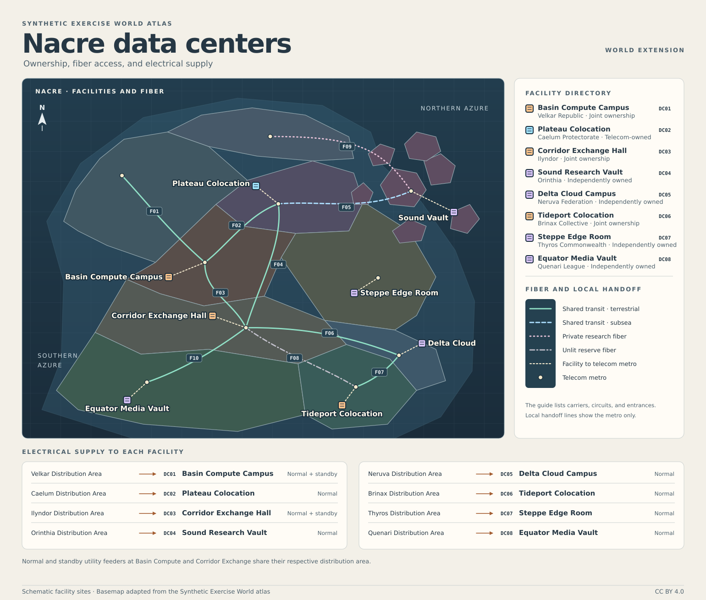

# Nacre data centers

This extension adds eight data centers with separate relationships for ownership, facility operation, network access, and utility power. It uses the existing carrier and fiber records from the [telecommunications extension](../telecom/README.md) and the distribution areas from the [electricity extension](../electricity/README.md).

The editable SVG has layers for the basemap, telecom backbone, facilities and their local handoffs, and electrical supply. Facility markers are offset on the map for readability. The tables give the circuit and utility feed details.

## Sites, ownership, and operations

| ID | Site | Country | Ownership | Facility operator |
|---|---|---|---|---|
| DC01 | Basin Compute Campus | Velkar Republic | Joint · BasinLink and HelixCore Group | BasinLink |
| DC02 | Plateau Colocation | Caelum Protectorate | Telecom · BlueBridge Networks | BlueBridge Networks |
| DC03 | Corridor Exchange Hall | Ilyndor | Joint · Corridor Exchange and CinderHarbor Group | NeutralGrid Colocation |
| DC04 | Sound Research Vault | Orinthia | Independent · IronCore Dynamics | IronCore Dynamics |
| DC05 | Delta Cloud Campus | Neruva Federation | Independent · Stratus Compute Services | Stratus Compute Services |
| DC06 | Tideport Colocation | Brinax Collective | Joint · Tidegrid Fiber and AuroraHarbor Dynamics | Tidegrid Fiber |
| DC07 | Steppe Edge Room | Thyros Commonwealth | Independent · VertexBridge Systems | VertexBridge Systems |
| DC08 | Equator Media Vault | Quenari League | Independent · QuantumMatrix Labs | QuantumMatrix Labs |

NeutralGrid Colocation runs the jointly owned Ilyndor hall. Stratus Compute Services owns and runs Delta Cloud Campus and contracts its circuits from two telecom companies. The independently owned enterprise sites buy access from their local telecom operators.

## Telecom and fiber access

The site handoff connects each facility to its local telecom metro. A circuit can be provided by the local operator or delivered from a partner across a listed fiber path. The carrier column identifies the provider of the circuit. The entry column identifies the building entrance shared by any circuits with the same entry code at that facility.

| Circuit | Facility | Carrier | Fiber path | Facility entry | Baseline access |
|---|---|---|---|---|---|
| C01 | DC01 | BasinLink | F01 · Iron Basin Trunk | north-entry | Shared transit |
| C02 | DC01 | BlueBridge Networks | F02 · Plateau Trunk | plateau-entry | Shared transit |
| C03 | DC02 | BlueBridge Networks | F02 · Plateau Trunk | west-entry | Shared transit |
| C04 | DC02 | BlueBridge Networks | F04 · Ridge Bypass | south-entry | Shared transit |
| C05 | DC03 | Corridor Exchange | F03 · Trade Corridor Spur | trade-entry | Shared transit |
| C06 | DC03 | BlueBridge Networks | F04 · Ridge Bypass | ridge-entry | Shared transit |
| C07 | DC04 | Pelagic Radio | F05 · Island Cable | harbor-entry | Shared transit |
| C08 | DC04 | Pelagic Radio | F09 · Polar Research Cable | research-entry | Private research traffic |
| C09 | DC05 | DeltaReach | F06 · Delta Trunk | delta-entry | Shared transit |
| C10 | DC05 | Tidegrid Fiber | F07 · Coastal Link | delta-entry | Shared transit |
| C11 | DC06 | Tidegrid Fiber | F07 · Coastal Link | coast-entry | Shared transit |
| C12 | DC06 | Corridor Exchange | F08 · Cooperative Reserve | reserve-entry | Unlit reserve |
| C13 | DC07 | SteppeWave | Local fiber | yard-entry | Domestic only |
| C14 | DC08 | Equator Air | F10 · Orchard Spur | orchard-entry | Shared transit |

Sound Research Vault uses F09 for approved research data. Tideport's F08 circuit becomes usable after the reserve fiber is commissioned. Steppe Edge Room's access ends within the domestic SteppeWave network. At Delta Cloud Campus, two backbone paths converge at the same building entrance.

## Electrical grid dependencies

Each utility feeder draws from a distribution area already linked to a grid hub in the electricity extension. Basin Compute Campus and Corridor Exchange Hall each have a normal and a standby feeder from the same local distribution area. A standby feeder provides a second local feed when its upstream distribution area remains energized.

| Facility | Distribution area | Grid hub | Utility feeds |
|---|---|---|---|
| DC01 | Velkar Distribution Area | Velkar Grid Hub | E01 normal, E02 standby |
| DC02 | Caelum Distribution Area | Caelum Grid Hub | E03 normal |
| DC03 | Ilyndor Distribution Area | Ilyndor Grid Hub | E04 normal, E05 standby |
| DC04 | Orinthia Distribution Area | Orinthia Grid Hub | E06 normal |
| DC05 | Neruva Distribution Area | Neruva Grid Hub | E07 normal |
| DC06 | Brinax Distribution Area | Brinax Grid Hub | E08 normal |
| DC07 | Thyros Distribution Area | Thyros Grid Hub | E09 normal |
| DC08 | Quenari Distribution Area | Quenari Grid Hub | E10 normal |

## Exercise case · A shared entrance goes offline

A storm floods the communications duct at Delta Cloud Campus. Both C09 and C10 lose facility access at `delta-entry`. The telecom operators confirm that F06 and F07 remain in service between their metros. A regional freight-booking application has a ready standby copy at Corridor Exchange Hall, where C05 and C06 are available and the Ilyndor Distribution Area remains energized.

During the recovery, the Neruva utility interrupts E07 for repair work. Both carrier circuits are restored before the utility clears the Delta site for normal operation.

**Participant task.** Decide where to keep the booking service available after each event. Record which organizations report on the site entrance, backbone routes, application readiness, and electricity supply. Agree on the checks needed before returning service to Delta.

**Facilitator check.** Bring the application up at Corridor Exchange Hall under NeutralGrid Colocation. Delta's Stratus Compute Services coordinates the entrance repair with DeltaReach and Tidegrid Fiber. Return service to Delta after its facility operator confirms that access is usable and E07 has returned to normal. The Ilyndor standby feeder shares the same distribution dependency as its normal feeder, and the Brinax reserve fiber is still unlit.

## MISP Galaxy

Load the base Synthetic Exercise World, the [telecom Galaxy files](../telecom/README.md#misp-galaxy), and the [electricity Galaxy files](../electricity/README.md#misp-galaxy). Then import the data center [Galaxy definition](galaxies/exercise-world-datacenters.json) and [cluster collection](clusters/exercise-world-datacenters.json). Use galaxy type `exercise-world-datacenters`.

| `meta.entity-type` | Relationships and fields |
|---|---|
| `data-center` | `owned-by` allows multiple owners. `operated-by` identifies the facility operator. `local-handoff-to` identifies the telecom metro. `located-in` references the base country. |
| `facility-company` | Represents the two new independent companies, with `located-in` links to their countries. |
| `facility-fiber-circuit` | `serves-facility` links to the site, `provided-by` to the telecom carrier, and `uses-fiber-route` to a backbone path when present. `facility-entry` and `access-policy` describe the entrance and allowed service. |
| `facility-power-feed` | `powers-facility` links to the site, and `draws-from` links to an electricity distribution area. Its existing `receives-from` relation identifies the grid hub. `feed-role` distinguishes normal and standby feeds. |

Facilities link back to their circuits with `connected-via` and to their feeders with `powered-via`. For dependency analysis, group circuits by facility and `facility-entry`, and group power feeds by distribution-area UUID.

Base country and company UUIDs were verified against [MISP Galaxy revision `779b780`](https://github.com/MISP/misp-galaxy/blob/779b780a13f67288d9b1a031b064fb140cdacaae/clusters/exercise-world.json).

The map adapts the Nacre atlas and reuses the telecom backbone paths. The extension is licensed under CC BY 4.0. [Original atlas](../../images/synthetic_exercise_world_clear_map.svg) · [Telecom map](../telecom/telecom-map.svg) · [License](../../LICENSE)
