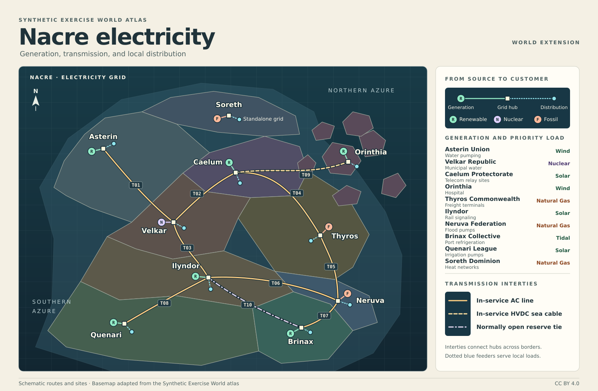

# Nacre electricity

This extension follows electricity from renewable, nuclear, and fossil generation through the transmission grid to local distribution. Each Nacre country has a representative generation site, a grid hub, and a distribution area serving example loads.

The SVG has editable layers for the basemap, transmission interties, and local systems. A lettered circle identifies the generation class, a square marks the grid hub, and a dotted blue feeder leads to local distribution. Sites, feeders, and routes are schematic.

## Generation and distribution

| Country | Generator | Source | Example priority loads on local distribution |
|---|---|---|---|
| Asterin Union | Northwind Farms | Renewable · wind | Water pumping, district heating |
| Velkar Republic | Basin Nuclear Station | Nuclear | Municipal water, heating plants |
| Caelum Protectorate | Plateau Solar Fields | Renewable · solar | Telecom relay sites, water treatment |
| Orinthia | East Isles Wind | Renewable · wind | Hospital, water pumps, island telecom core |
| Thyros Commonwealth | Steppe Gas Station | Fossil · natural gas | Freight terminals, water pumping |
| Ilyndor | Corridor Solar Fields | Renewable · solar | Rail signaling, public service buildings |
| Neruva Federation | Delta Gas Station | Fossil · natural gas | Flood pumps, port controls |
| Brinax Collective | Tidegate Array | Renewable · tidal | Port refrigeration, cooperative dispatch center |
| Quenari League | Equator Solar Fields | Renewable · solar | Irrigation pumps, food storage |
| Soreth Dominion | Polar Gas Station | Fossil · natural gas | Heat networks, cold-chain depots |

Grid hubs connect local generation and interties to distribution. Each distribution area represents a group of feeders that serve households, businesses, and priority services.

## Transmission grid

| Intertie | Grid hubs | Technology and medium | Baseline status |
|---|---|---|---|
| T01 · North Basin Line | Asterin ↔ Velkar | Terrestrial AC | In service |
| T02 · Plateau Line | Velkar ↔ Caelum | Terrestrial AC | In service |
| T03 · Trade Corridor Line | Velkar ↔ Ilyndor | Terrestrial AC | In service |
| T04 · Steppe Exchange | Caelum ↔ Thyros | Terrestrial AC | In service |
| T05 · Delta–Steppe Line | Thyros ↔ Neruva | Terrestrial AC | In service |
| T06 · Delta Trunk | Ilyndor ↔ Neruva | Terrestrial AC | In service |
| T07 · Coastal Tie | Neruva ↔ Brinax | Terrestrial AC | In service |
| T08 · Equator Spur | Ilyndor ↔ Quenari | Terrestrial AC | In service |
| T09 · Archipelago Cable | Caelum ↔ Orinthia | Subsea high-voltage direct current (HVDC) | In service |
| T10 · Cooperative Reserve Tie | Ilyndor ↔ Brinax | Terrestrial AC | Normally open |

Eight mainland areas share the AC grid. Orinthia exchanges power over the Archipelago Cable, its sole intertie. Soreth operates a standalone grid. The Cooperative Reserve Tie is open in the baseline. The intertie table describes connectivity. The exercise supplies the island's available power and demand separately.

## Exercise case · An island runs short

Orinthia starts with a 40 MW load and two sources of supply. East Isles Wind provides 24 MW, and the Archipelago Cable imports 16 MW. Priority loads total 18 MW across the hospital, water pumps, and island telecom core. Other loads total 22 MW.

| Inject | Change |
|---|---|
| 1 · Cable outage | A storm takes the Archipelago Cable (T09) out of service. The island continues operating with its available 24 MW of wind generation. |
| 2 · Wind drops | While the cable is unavailable, wind output falls to 16 MW. |

Assume stable island operation for the tabletop. The balances use the stated loads and available supply and ignore electrical losses and ramping.

**Participant task.** Identify which grid areas are still connected. After each inject, calculate how much demand the island can serve and agree which services to prioritize. Draft a joint update for distributors and service operators, including when each should activate its continuity plans.

**Facilitator check.** After inject 1, 24 MW covers the 18 MW of priority load and 6 MW of other demand. The island must defer 16 MW. After inject 2, the island must defer 24 MW in total and is 2 MW short even before serving other demand. Mainland generation remains on the other side of T09, and the reserve tie connects two mainland hubs. Participants should explain which priority services need contingency arrangements while the island waits for imports or wind output to recover.

## MISP Galaxy

Load the base Synthetic Exercise World galaxy and cluster collection first, then import the electricity [Galaxy definition](galaxies/exercise-world-electricity.json) and [cluster collection](clusters/exercise-world-electricity.json). Use the galaxy type `exercise-world-electricity`.

The collection contains four entity families.

| `meta.entity-type` | Metadata and relationships |
|---|---|
| `generation-source` | `source-class` identifies renewable, nuclear, or fossil generation, and `technology` identifies the specific source. Each generator `supplies` its hub. |
| `grid-hub` | `grid-mode` identifies interconnected or standalone operation. Each hub is `located-in` a base country by UUID, `receives-from` its generator, `supplies` its distribution area, and `terminates` its interties. |
| `distribution-area` | `priority-loads` lists representative services. Each area `receives-from` its hub. |
| `transmission-intertie` | `route-id` ties the record to the map. `technology` and `line-medium` describe the link, and `grid-state` identifies whether it is in service or normally open. Each intertie is `terminated-by` two hubs. |

To reconstruct baseline connectivity, join each intertie to its two hub UUIDs and include only records with `meta.grid-state` set to `in-service`.

The country UUIDs were verified against [MISP Galaxy revision `779b780`](https://github.com/MISP/misp-galaxy/blob/779b780a13f67288d9b1a031b064fb140cdacaae/clusters/exercise-world.json).

The map uses recolored country outlines from the Synthetic Exercise World atlas and adds the electricity layers. The extension is licensed under CC BY 4.0. [Original atlas](../../images/synthetic_exercise_world_clear_map.svg) · [License](../../LICENSE)
