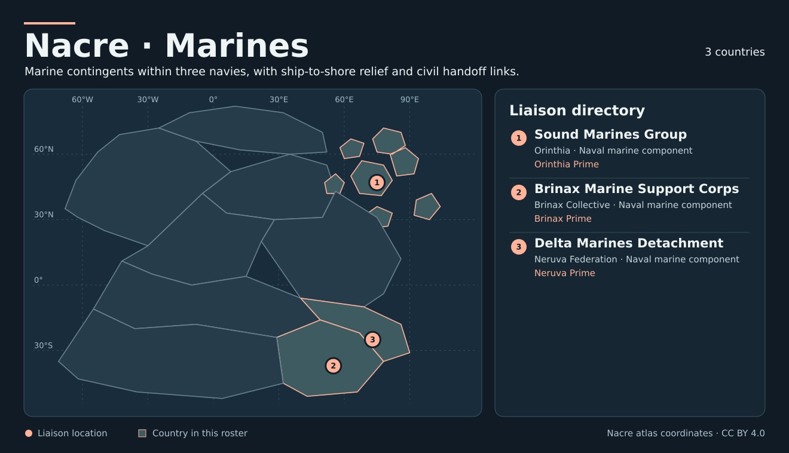

# Nacre marines

Orinthia, Brinax, and Neruva organize their marine contingents under their navies. The roster models ship-to-shore relief handoffs and contact points for ports and civil responders. Each map marker is a liaison location.

## Country roster

| Country | Service | Organization | Liaison site | Exercise role |
|---|---|---|---|---|
| Orinthia | Sound Marines Group | Naval marine component | Orinthia Prime | Coordinates island relief transfers between Sound Harbor and civil receiving teams. |
| Brinax Collective | Brinax Marine Support Corps | Naval marine component | Brinax Prime | Coordinates ship-to-shore cargo custody and receiving confirmations. |
| Neruva Federation | Delta Marines Detachment | Naval marine component | Neruva Prime | Reconciles maritime relief manifests with shore and shelter receiving teams. |

Liaison points use the capital coordinates on the shared fictional grid. Each detachment also links to the port and civil receiving team it coordinates with. [Nacre geographic atlas](../../geography/README.md)

## Exercise case · A dockside manifest differs

A navy manifest lists 18 relief parcels for transfer at Delta Port. The Neruva landing liaison counts 17 parcels on the quay. The Riverbank Emergency Shelter has a matching 17-item receipt prepared and is waiting for the handoff.

**Participant task.** Reconcile the carrier and shore records, identify who signs for each transfer, and agree how the outstanding parcel appears in the shared report.

**Facilitator check.** The Neruva Delta Navy preserves the carrier's 18-item manifest. The Delta Marines Detachment records custody of 17 parcels and gives the shelter staff a 17-item transfer record. Enter a single open discrepancy against the original manifest and assign a follow-up owner at Delta Port.

## MISP Galaxy

Load the base Synthetic Exercise World and the linked records from [navy](../navy/README.md#misp-galaxy), [transport and logistics](../transport/README.md#misp-galaxy), and [civil and humanitarian services](../civil-humanitarian/README.md#misp-galaxy). Import the [Galaxy definition](galaxies/exercise-world-marines.json) and [cluster collection](clusters/exercise-world-marines.json) under type `exercise-world-marines`.

| Relationship | Meaning |
|---|---|
| `located-in` | References the service’s country in the base Galaxy. |
| `coordinates-with` | References a civil or defense partner for the exercise role. |
| `part-of` | Identifies the parent service for a named component. |

The geographic feature ID matches the service cluster UUID. Base country references use the pinned [MISP Galaxy revision `779b780`](https://github.com/MISP/misp-galaxy/blob/779b780a13f67288d9b1a031b064fb140cdacaae/clusters/exercise-world.json).

The map adapts Nacre’s geography under CC BY 4.0. [Original atlas](../../images/synthetic_exercise_world_clear_map.svg) · [License](../../LICENSE)
