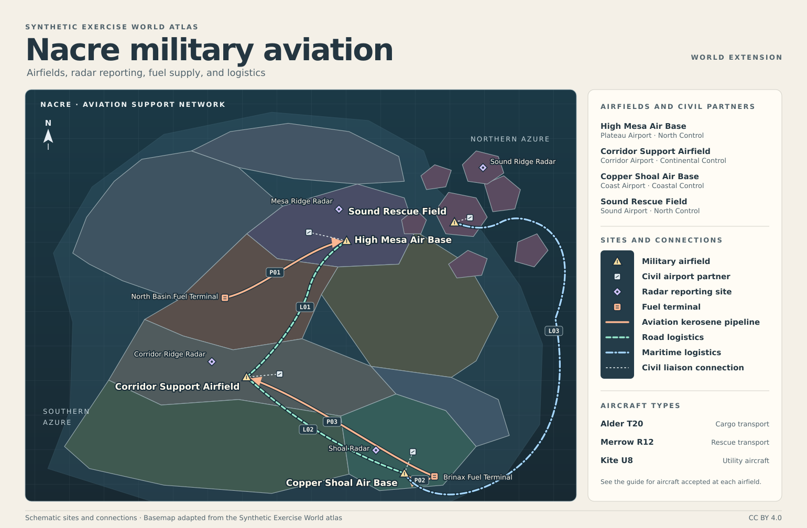

# Nacre military aviation

This extension adds fictional military transport and rescue aircraft, four airfields, radar reporting sites, aviation kerosene pipelines, and road and maritime logistics. It uses the airports and control centers already defined in the [civil aviation extension](../aviation/README.md).

The editable SVG has separate layers for the basemap, fuel pipelines, logistics routes, civil airport liaison, and sites. Pipeline arrows show the direction of fuel delivery. Radar symbols mark reporting sites and dotted civil liaison lines show coordination relationships. Site locations and routes are schematic.

## Aircraft and airfields

| Aircraft | Role | Example loads or missions |
|---|---|---|
| Alder T20 | Cargo transport | Palletised relief supplies and maintenance stores |
| Merrow R12 | Rescue transport | Rescue teams, medical transfers, and urgent relief supplies |
| Kite U8 | Utility aircraft | Liaison teams and light cargo |

| Country | Military airfield | Aircraft accepted | Civil airport partner | En-route coordination |
|---|---|---|---|---|
| Caelum Protectorate | High Mesa Air Base | Alder T20, Kite U8 | Plateau Airport | North Control |
| Ilyndor | Corridor Support Airfield | Alder T20, Kite U8 | Corridor Airport | Continental Control |
| Brinax Collective | Copper Shoal Air Base | Alder T20, Merrow R12 | Coast Airport | Coastal Control |
| Orinthia | Sound Rescue Field | Merrow R12, Kite U8 | Sound Airport | North Control |

Military airfield teams manage local aircraft and ground handling. Civil airport partners share local traffic and availability updates. The civil en-route centers coordinate shared airspace for flights between areas.

## Radar reporting

| Site | Supports | Civil reporting partner |
|---|---|---|
| Mesa Ridge Radar | High Mesa Air Base | North Control |
| Corridor Ridge Radar | Corridor Support Airfield | Continental Control |
| Shoal Radar | Copper Shoal Air Base | Coastal Control |
| Sound Ridge Radar | Sound Rescue Field | North Control |

Each site supplies air traffic reports and reports its availability to the linked center. The exercise uses those updates to inform civil and military coordination.

## Fuel and logistics

North Basin Fuel Terminal in Velkar and Brinax Fuel Terminal supply aviation kerosene to mainland airfields. Sound Rescue Field receives stores and kerosene over the maritime logistics link. The sea service includes transfers between the stores quays and the two airfields.

| Pipeline | Terminal → Airfield |
|---|---|
| P01 · Plateau Kerosene Line | North Basin Fuel Terminal → High Mesa Air Base |
| P02 · Copper Shoal Kerosene Line | Brinax Fuel Terminal → Copper Shoal Air Base |
| P03 · Corridor Kerosene Line | Brinax Fuel Terminal → Corridor Support Airfield |

| Logistics link | Endpoints | Mode | Cargo |
|---|---|---|---|
| L01 · Corridor–Mesa Road | Corridor Support Airfield ↔ High Mesa Air Base | Road | Relief supplies, maintenance stores |
| L02 · Brinax–Corridor Supply Road | Copper Shoal Air Base ↔ Corridor Support Airfield | Road | Relief supplies, ground equipment |
| L03 · Sound Stores Service | Copper Shoal Air Base ↔ Sound Rescue Field | Sea | Relief supplies, aviation kerosene |

## Exercise case · Relief supplies for Sound

After a storm, civil authorities request urgent medical supplies and other relief stores for Orinthia. Both shipments are staged at Corridor Support Airfield. The initial plan sends the urgent supplies via High Mesa on L01 for a Kite U8 flight to Sound Rescue Field. P01 is paused for inspection, so High Mesa cannot confirm fuel for the flight. Sound Ridge Radar also reports an interruption to its traffic reporting service.

Copper Shoal confirms that P02 is supplying fuel. A Merrow R12 is available at Copper Shoal, and Sound Rescue Field can receive it in the exercise. L02 and L03 remain available for freight.

**Participant task.** Trace an alternate route for the two shipments, confirm aircraft and fuel availability, and draft a joint update for the military airfields, civil airport partners, and regional controllers. Identify who confirms the island arrival before the urgent shipment is dispatched.

**Facilitator check.** Stage both shipments at Copper Shoal via L02. Assign the Merrow R12 to the urgent shipment once the receiving airfield and civil controllers confirm the flight, and move the remaining stores by L03. Have Sound Ridge report the interruption to North Control. Coastal Control and North Control coordinate the cross-area flight, with the military fields and their civil airport partners sharing local status. Track delivery and keep the flight pending until those confirmations are in place.

## MISP Galaxy

Load the base Synthetic Exercise World galaxy and cluster collection and the [civil aviation Galaxy files](../aviation/README.md#misp-galaxy), then import the military aviation [Galaxy definition](galaxies/exercise-world-military-aviation.json) and [cluster collection](clusters/exercise-world-military-aviation.json). Use galaxy type `exercise-world-military-aviation`.

| `meta.entity-type` | Relationships |
|---|---|
| `military-aircraft-type` | `operates-from` lists airfields, which link back with `accepts-aircraft`. |
| `military-airfield` | `located-in` references a base country. `liaises-with` and `coordinates-with` reference a civil airport and en-route center, respectively. |
| `radar-reporting-site` | `supports` identifies the military airfield, and `reports-to` references the civil en-route center. |
| `aviation-fuel-terminal` and `aviation-fuel-pipeline` | Each pipeline `originates-at` a terminal and `supplies` an airfield. The terminal `feeds` the pipeline and the airfield links back with `receives-fuel-via`. |
| `military-logistics-route` | `terminated-by` links both airfields, which link back with `terminates`. `transport-mode` and `cargo` describe the service. |

Pipeline and logistics records use `meta.route-id` to match the map. Civil references use the UUIDs from the [civil aviation cluster collection](../aviation/clusters/exercise-world-aviation.json). Base country references use [MISP Galaxy revision `779b780`](https://github.com/MISP/misp-galaxy/blob/779b780a13f67288d9b1a031b064fb140cdacaae/clusters/exercise-world.json).

The map uses recolored country outlines from the Synthetic Exercise World atlas and adds the aviation support layers. The extension is licensed under CC BY 4.0. [Original atlas](../../images/synthetic_exercise_world_clear_map.svg) · [License](../../LICENSE)
