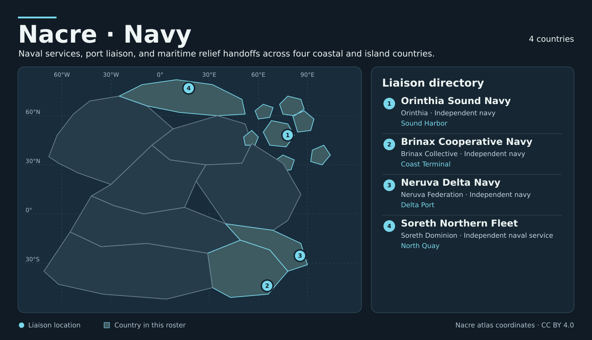

# Nacre navy

Four coastal and island countries field naval services. The roster covers fleet administration, port liaison, and the coordination of maritime relief cargo. Coast guards handle the rescue and maritime safety roles described in their own extension.

## Country roster

| Country | Service | Organization | Liaison site | Exercise role |
|---|---|---|---|---|
| Orinthia | Orinthia Sound Navy | Independent navy | Sound Harbor | Coordinates island port liaison and maritime relief consignments departing Sound Harbor. |
| Brinax Collective | Brinax Cooperative Navy | Independent navy | Coast Terminal | Coordinates terminal access and receiving arrangements for maritime relief cargo. |
| Neruva Federation | Neruva Delta Navy | Independent navy | Delta Port | Maintains fleet administration and liaises with Delta Port on incoming relief manifests. |
| Soreth Dominion | Soreth Northern Fleet | Independent naval service | North Quay | Coordinates cold-chain and port availability updates for northern supply services. |

Liaison points inherit the coordinates of their named hosts on the shared fictional grid. Highlighted countries have a service represented in this roster. [Nacre geographic atlas](../../geography/README.md)

The [marines roster](../marines/README.md) links each contingent to its parent navy. The [coast guard roster](../coast-guard/README.md) identifies rescue partners, including the Soreth Polar Coast Guard within the Northern Fleet.

## Exercise case · Stores wait at Sound Harbor

The scheduled relief delivery from Sound Harbor to Delta Port is delayed by a berth closure. Sound Harbor can hold the shipment. Delta Port expects to offer a new receiving slot after an inspection, and the scheduled carrier needs one agreed update from both ports.

**Participant task.** Have the dispatch and receiving liaison teams reconcile the cargo record. Decide what information the carrier needs and what remains pending until the new slot is confirmed.

**Facilitator check.** The Orinthia Sound Navy confirms custody at Sound Harbor. The Neruva Delta Navy obtains receiving status from Delta Port. Both teams use the same consignment reference and mark the replacement arrival window as provisional until Delta Port confirms it.

## MISP Galaxy

Load the base Synthetic Exercise World and the linked records from [transport and logistics](../transport/README.md#misp-galaxy). Import the [Galaxy definition](galaxies/exercise-world-navy.json) and [cluster collection](clusters/exercise-world-navy.json) under type `exercise-world-navy`.

| Relationship | Meaning |
|---|---|
| `located-in` | References the service’s country in the base Galaxy. |
| `has-liaison-at` | References an existing host facility. The liaison point uses the host’s coordinates. |
| `coordinates-with` | References a civil or defense partner for the exercise role. |

The geographic feature ID matches the service cluster UUID. Base country references use the pinned [MISP Galaxy revision `779b780`](https://github.com/MISP/misp-galaxy/blob/779b780a13f67288d9b1a031b064fb140cdacaae/clusters/exercise-world.json).

The map adapts Nacre’s geography under CC BY 4.0. [Original atlas](../../images/synthetic_exercise_world_clear_map.svg) · [License](../../LICENSE)
