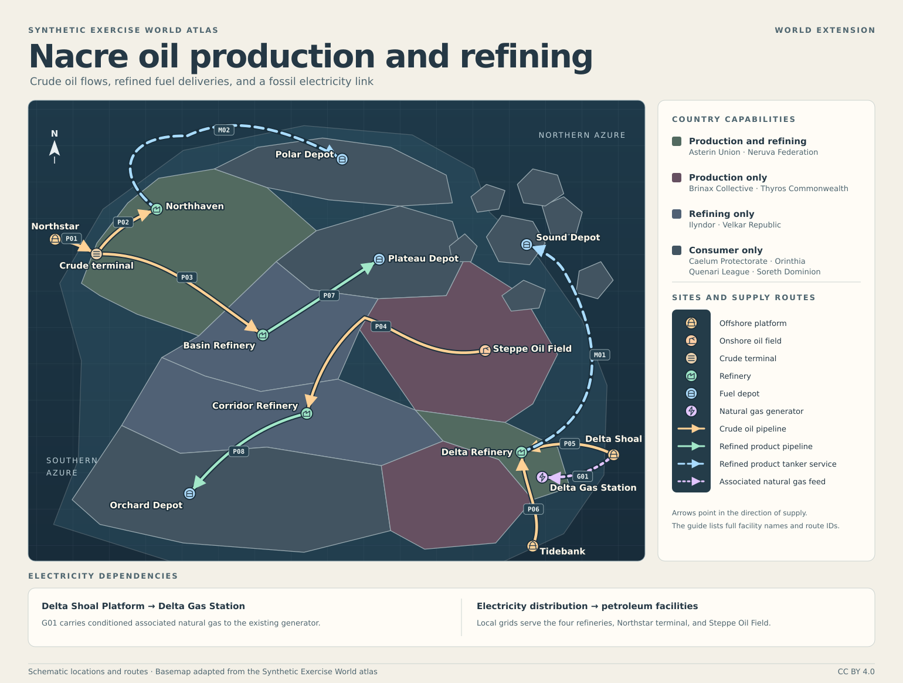

# Nacre oil production and refining

This extension follows crude oil from onshore and offshore production through terminals and refineries to refined fuel deliveries. It covers all ten countries, with different roles in the modeled petroleum network, and links to the [electricity extension](../electricity/README.md).

The editable SVG separates country capabilities, sites, routes, and electrical dependencies. Arrows show the modeled direction of supply. Locations and routes are schematic.

## Country capabilities

| Capability | Countries | Function in the modeled network |
|---|---|---|
| Production and refining | Asterin Union, Neruva Federation | Offshore crude production and domestic refinery capacity |
| Production only | Brinax Collective, Thyros Commonwealth | Crude production and exports to another country's refinery |
| Refining only | Ilyndor, Velkar Republic | Refining imported crude |
| Consumer only | Caelum Protectorate, Orinthia, Quenari League, Soreth Dominion | Receives refined diesel at a depot |

## Supply sites

| Site | Country | Modeled function |
|---|---|---|
| Northstar Shelf Platform | Asterin Union | Offshore crude production |
| Northstar Crude Terminal | Asterin Union | Crude landing and onward distribution |
| Northhaven Refinery | Asterin Union | Refines crude and supplies diesel |
| Basin Refinery | Velkar Republic | Refines crude and supplies diesel |
| Steppe Oil Field | Thyros Commonwealth | Onshore crude production |
| Corridor Refinery | Ilyndor | Refines crude and supplies diesel |
| Delta Shoal Platform | Neruva Federation | Offshore crude and associated natural gas production |
| Tidebank Platform | Brinax Collective | Offshore crude production |
| Delta Refinery | Neruva Federation | Refines crude and supplies diesel |
| Plateau Fuel Depot | Caelum Protectorate | Receives refined diesel |
| Sound Fuel Depot | Orinthia | Receives refined diesel |
| Orchard Fuel Depot | Quenari League | Receives refined diesel |
| Polar Stores Depot | Soreth Dominion | Receives refined diesel |

## Pipelines and tanker routes

Crude reaches the refineries by pipeline. The refined diesel routes include pipelines and coastal tanker services. Tanker routes represent end-to-end deliveries with local terminal handoffs.

| Route | Supply direction | Commodity | Transport |
|---|---|---|---|
| P01 · Northstar Landing Line | Northstar Shelf Platform → Northstar Crude Terminal | Crude oil | Pipeline |
| P02 · Northhaven Feed Line | Northstar Crude Terminal → Northhaven Refinery | Crude oil | Pipeline |
| P03 · Basin Crude Line | Northstar Crude Terminal → Basin Refinery | Crude oil | Pipeline |
| P04 · Steppe–Corridor Crude Line | Steppe Oil Field → Corridor Refinery | Crude oil | Pipeline |
| P05 · Delta Shoal Crude Line | Delta Shoal Platform → Delta Refinery | Crude oil | Pipeline |
| P06 · Tidebank Crude Line | Tidebank Platform → Delta Refinery | Crude oil | Pipeline |
| P07 · Plateau Product Line | Basin Refinery → Plateau Fuel Depot | Diesel | Pipeline |
| P08 · Orchard Product Line | Corridor Refinery → Orchard Fuel Depot | Diesel | Pipeline |
| M01 · Sound Product Tanker Route | Delta Refinery → Sound Fuel Depot | Diesel | Tanker service |
| M02 · Polar Product Tanker Route | Northhaven Refinery → Polar Stores Depot | Diesel | Tanker service |
| G01 · Delta Associated Gas Feed | Delta Shoal Platform → Delta Gas Station | Conditioned natural gas | Gas feed |

## Links to the electricity grid

G01 represents delivery of conditioned associated natural gas from Delta Shoal Platform to the existing **Delta Gas Station**. The gas feed includes the conditioning handoff. The generator's electricity record identifies natural gas as its fuel.

The four refineries, Northstar Crude Terminal, and Steppe Oil Field draw electricity from their local distribution areas. The electricity Galaxy identifies the grid hub behind each of those areas.

## Exercise case · Offshore supply interruption

A storm pauses production at Delta Shoal Platform. The Delta Refinery loses its P05 crude deliveries and Delta Gas Station loses the G01 associated gas feed. Tidebank Platform and P06 remain available, and the local electricity distribution area continues supplying the refinery.

Delta Refinery has 18 units of finished diesel cleared for dispatch in the exercise window, including stock. Neruva needs ten units for priority local services. Sound Fuel Depot has requested 12 units, and the M01 tanker has room for all 12. Use the units as a tabletop allocation measure.

**Participant task.** Trace the refinery's remaining crude route, allocate the available diesel, and draft separate updates for the two fuel customers and the electricity operator. Identify which teams confirm crude intake, product stock, and generation availability.

**Facilitator check.** Tidebank can still supply crude through P06. Allocate ten diesel units to Neruva and eight to the Sound tanker, leaving a four-unit shortfall at Sound. The electricity operator must confirm what other natural gas is available to Delta Gas Station and report the resulting generation status. Base the dispatch plan on the stated finished stock and confirmed electricity supply.

## MISP Galaxy

Load the base world and the [electricity Galaxy files](../electricity/README.md#misp-galaxy). Then import the [Galaxy definition](galaxies/exercise-world-oil-refining.json) and [cluster collection](clusters/exercise-world-oil-refining.json). Use galaxy type `exercise-world-oil-refining`.

| `meta.entity-type` | Relationships and fields |
|---|---|
| `petroleum-country-profile` | `profiles-country` identifies the original country by UUID, `includes-site` identifies its modeled sites, and `supply-role` describes its capability. |
| `petroleum-site` | `site-kind` distinguishes platforms, fields, terminals, refineries, and depots. `sends-via` and `receives-via` identify supply routes. `draws-power-from` points to an electricity distribution area by UUID. |
| `petroleum-supply-route` | `route-id` matches the map, and `commodity` and `transport-mode` describe what moves. `originates-at` and `delivers-to` give the direction. G01 uses `supplies-fuel-to` to reference the fossil generator in the electricity Galaxy. |

Country references use existing Nacre UUIDs. [MISP Galaxy revision `779b780`](https://github.com/MISP/misp-galaxy/blob/779b780a13f67288d9b1a031b064fb140cdacaae/clusters/exercise-world.json)

The map adapts the Nacre atlas under CC BY 4.0. [Original atlas](../../images/synthetic_exercise_world_clear_map.svg) · [License](../../LICENSE)
