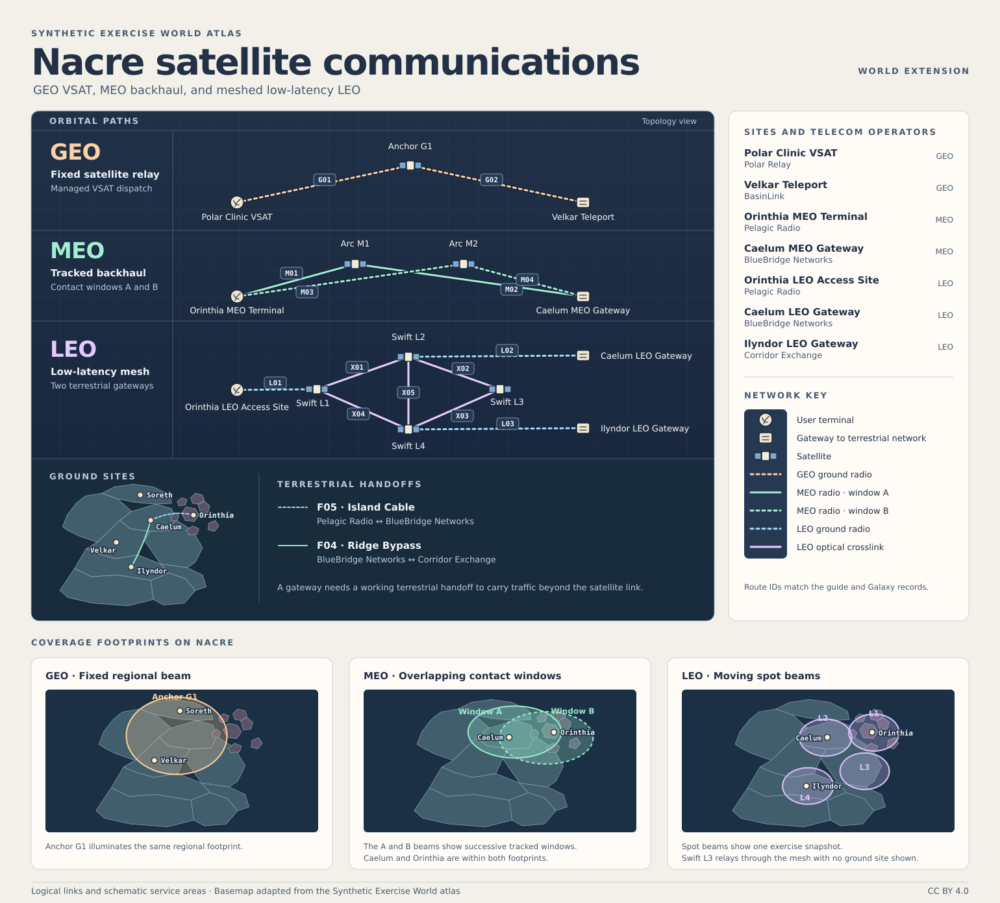

# Nacre satellite communications

This extension adds three satellite services linked to existing operators in the [telecommunications extension](../telecom/README.md). It models a fixed GEO relay for VSAT terminals, tracked MEO backhaul, and a meshed LEO network with two terrestrial gateways.

The editable SVG separates the three orbital networks, coverage footprints, and ground inset into layers. The orbital view shows logical connectivity. The ground inset shows representative site locations and two relevant fiber routes.

## Services

| Service | Orbit and topology | Traffic carried in the exercise |
|---|---|---|
| Anchor GEO VSAT | Geostationary relay. Anchor G1 appears fixed above Nacre, and the very small aperture terminal (VSAT) uses a fixed dish. | Managed dispatch from Polar Clinic to Velkar Teleport. |
| Arc MEO Backhaul | Medium Earth orbit relays. The ground sites track Arc M1 in contact window A and Arc M2 in window B. Each window needs both radio legs through the same relay. | Managed medical backhaul between Orinthia and Caelum. |
| Swift LEO Mesh | Low Earth orbit. Four satellites form a mesh with five optical crosslinks and feeder links to two terrestrial gateways. | Priority shared transit for Pelagic Radio, including interactive services. |

GEO has the longest propagation path of these modeled services. MEO reduces propagation delay on comparable paths, while LEO combines shorter radio legs with routing between satellites. End-to-end latency depends on the selected path, the gateway handoff, and how much traffic the network is carrying.

## Coverage footprints

| Orbit | Footprint | Ground sites in view |
|---|---|---|
| GEO | Anchor G1 has a fixed regional beam. | Polar Clinic VSAT and Velkar Teleport. |
| MEO | Arc M1 and M2 have moving regional beams, drawn for contact windows A and B. | The Orinthia terminal and Caelum gateway lie in both illustrated footprints. |
| LEO | Each Swift satellite has a smaller moving spot beam, drawn for one exercise snapshot. | L1 covers the Orinthia access site, L2 covers the Caelum gateway, and L4 covers the Ilyndor gateway. L3 is a relay in this snapshot. |

The footprints are schematic. Coverage describes where a site lies under an illustrated beam. Service also depends on the active radio links, the terrestrial handoff, and the traffic policy.

## Ground sites and telecom partners

| Ground site | Country | Role | Telecom operator |
|---|---|---|---|
| Polar Clinic VSAT | Soreth Dominion | GEO user terminal | Polar Relay |
| Velkar Teleport | Velkar Republic | GEO gateway | BasinLink |
| Orinthia MEO Terminal | Orinthia | MEO user terminal | Pelagic Radio |
| Caelum MEO Gateway | Caelum Protectorate | MEO gateway | BlueBridge Networks |
| Orinthia LEO Access Site | Orinthia | LEO user terminal | Pelagic Radio |
| Caelum LEO Gateway | Caelum Protectorate | LEO gateway | BlueBridge Networks |
| Ilyndor LEO Gateway | Ilyndor | LEO gateway | Corridor Exchange |

Gateways hand satellite traffic to the attached operator within the service's traffic policy. The Island Cable (F05) is Pelagic Radio's usual shared-transit link to BlueBridge. The Ridge Bypass (F04) connects BlueBridge and Corridor Exchange through the terrestrial network. GEO clinic dispatch and MEO medical backhaul use managed services. Swift LEO provides the modeled shared-transit fallback for priority traffic.

## Satellite links

| ID | Endpoints | Link |
|---|---|---|
| G01 | Polar Clinic VSAT ↔ Anchor G1 | GEO ground radio |
| G02 | Anchor G1 ↔ Velkar Teleport | GEO ground radio |
| M01 | Orinthia MEO Terminal ↔ Arc M1 | MEO ground radio · window A |
| M02 | Arc M1 ↔ Caelum MEO Gateway | MEO ground radio · window A |
| M03 | Orinthia MEO Terminal ↔ Arc M2 | MEO ground radio · window B |
| M04 | Arc M2 ↔ Caelum MEO Gateway | MEO ground radio · window B |
| L01 | Orinthia LEO Access Site ↔ Swift L1 | LEO ground radio |
| L02 | Swift L2 ↔ Caelum LEO Gateway | LEO ground radio |
| L03 | Swift L4 ↔ Ilyndor LEO Gateway | LEO ground radio |
| X01 | Swift L1 ↔ Swift L2 | Optical crosslink |
| X02 | Swift L2 ↔ Swift L3 | Optical crosslink |
| X03 | Swift L3 ↔ Swift L4 | Optical crosslink |
| X04 | Swift L4 ↔ Swift L1 | Optical crosslink |
| X05 | Swift L2 ↔ Swift L4 | Optical crosslink |

Treat each link as bidirectional within the stated contact window or exercise snapshot. For the MEO handover, switch from the complete window A path to the complete window B path. For LEO, the crosslink table describes a single representative network state.

## Exercise case · Orinthia loses its island cable

A storm hits Orinthia. Pelagic Radio retains local radio coverage and needs to maintain priority shared transit and managed medical traffic. Both LEO gateways are initially available, and the first MEO contact is window A.

| Inject | Change |
|---|---|
| 1 · Island Cable outage | F05 is unavailable. The MEO service moves from window A to window B during the exercise. |
| 2 · Caelum gateway outage | A local power problem takes both Caelum satellite gateways offline. BlueBridge's terrestrial core and F04 remain available. LEO crosslink X04 is also unavailable in the current snapshot. |

**Participant task.** Trace a permitted path for each traffic class after each inject. Identify the satellites, active links, and terrestrial handoff, then draft a joint service update for Pelagic Radio, BlueBridge Networks, and Corridor Exchange.

**Facilitator check.** After inject 1, Swift can reach BlueBridge through L01, X01, and L02. Arc still carries managed medical traffic via M01 and M02 during window A and M03 and M04 during window B. After inject 2, Arc loses its only gateway. Swift can still use L01, X01, X05, and L03 to reach Corridor Exchange through Swift L2 and Swift L4. Swift L2 continues to relay even though its Caelum feeder is unavailable. Corridor Exchange can reach BlueBridge's terrestrial core via F04. Soreth's GEO VSAT remains available for its clinic dispatch service.

## MISP Galaxy

Load the base Synthetic Exercise World and the [telecommunications Galaxy files](../telecom/README.md#misp-galaxy), then import the satellite communications [Galaxy definition](galaxies/exercise-world-satellite-communications.json) and [cluster collection](clusters/exercise-world-satellite-communications.json). Use galaxy type `exercise-world-satellite-communications`.

| `meta.entity-type` | Metadata and relationships |
|---|---|
| `satellite-service` | `orbit-class`, `topology`, and `traffic-class` describe the service. `uses-satellite`, `uses-site`, and `uses-link` associate its components. Arc and Swift link to F05 with `provides-fallback-for`. |
| `satellite` | `orbit-class` identifies GEO, MEO, or LEO. `footprint-kind` describes the beam, and `footprint-window` marks the illustrated MEO window. `covers-site` links to sites within that footprint. Each satellite `terminates` its active or modeled links. |
| `satellite-ground-site` | `ground-role` identifies a user terminal or gateway. `located-in` references the base country and `hands-off-to` references the telecom operator. |
| `satellite-link` | `route-id` matches the map. `link-kind` distinguishes radio and optical links, and MEO links carry a `contact-window`. Each link is `terminated-by` two endpoints. |

Operator and Island Cable UUIDs come from the [telecom cluster collection](../telecom/clusters/exercise-world-telecom.json). Country UUIDs come from [MISP Galaxy revision `779b780`](https://github.com/MISP/misp-galaxy/blob/779b780a13f67288d9b1a031b064fb140cdacaae/clusters/exercise-world.json).

The ground inset uses recolored country outlines from the Synthetic Exercise World atlas. The extension is licensed under CC BY 4.0. [Original atlas](../../images/synthetic_exercise_world_clear_map.svg) · [License](../../LICENSE)
