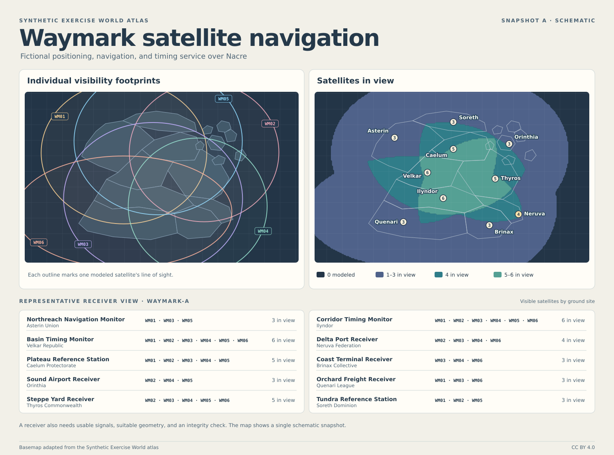

# Waymark satellite navigation

Waymark is a fictional, GPS-like positioning, navigation, and timing (PNT) service for Nacre. Satellites in medium orbit broadcast navigation and time signals one way. Ground receivers use several broadcasts to estimate position and time, and reference monitors publish local reception and integrity observations.

## Footprints and coverage

The editable SVG shows six individual visibility outlines and a shaded map of their overlap. The directory gives the exact satellite IDs in view at each example site in snapshot `WAYMARK-A`. The footprints are schematic. Visibility changes with time, receiver location, and local obstructions.

A standalone 3D fix generally needs at least four independent satellite observations to solve for position and receiver clock offset. Signal quality, satellite geometry, and integrity checks still govern which fixes a receiver can trust. Timing-only services can have different acceptance criteria. In the exercise, track baseline visibility, usable observations, position availability, and timing quality separately.

| Ground site | Country | Existing facility or operator | Satellites in view |
|---|---|---|---|
| Northreach Navigation Monitor | Asterin Union | Northreach Airport | WM01, WM03, WM05 |
| Basin Timing Monitor | Velkar Republic | BasinLink | WM01, WM02, WM03, WM04, WM05, WM06 |
| Plateau Reference Station | Caelum Protectorate | Plateau Airport | WM01, WM02, WM03, WM04, WM05 |
| Sound Airport Receiver | Orinthia | Sound Airport | WM02, WM04, WM05 |
| Steppe Yard Receiver | Thyros Commonwealth | Steppe Yard | WM02, WM03, WM04, WM05, WM06 |
| Corridor Timing Monitor | Ilyndor | Corridor Exchange | WM01, WM02, WM03, WM04, WM05, WM06 |
| Delta Port Receiver | Neruva Federation | Delta Port | WM02, WM03, WM04, WM06 |
| Coast Terminal Receiver | Brinax Collective | Coast Terminal | WM03, WM04, WM06 |
| Orchard Freight Receiver | Quenari League | Orchard Market Terminal | WM01, WM03, WM06 |
| Tundra Reference Station | Soreth Dominion | Tundra Airfield | WM01, WM02, WM05 |

## Exercise case · Suspected jamming at Delta Port

Before the exercise, identify the services that depend on Waymark, confirm their independent fallback sources, and agree on the criteria for returning to normal service.

Delta Port starts in the coverage snapshot with WM02, WM03, WM04, and WM06 in view and a valid position fix. During the incident, two local receivers report degraded signal quality and an interference alert. Only WM02 and WM04 remain usable. The position fix becomes unavailable, and the port clock enters holdover on its local oscillator. The Plateau Reference Station and Corridor Timing Monitor both report normal reception against their own baselines.

**Participant task.** Compare local and regional observations, declare which port services have lost trusted PNT, and coordinate a service update with port operations. Use the port's established independent position checks and approved fallback procedures. Track the start of timing holdover and which systems depend on the port clock. Agree on the evidence needed before returning to normal service.

**Facilitator check.** Four satellites remain in the modeled footprint, and two usable observations leave the affected receivers without a new standalone 3D fix. Local interference is consistent with the observations. Record it as suspected until confirmed. Preserve receiver alerts and quality logs and check timing against a separate reference. Holdover can support timing while it remains within the service's approved error budget. Before restoring normal operation, verify a stable position against an independent reference and confirm timing and integrity status.

## MISP Galaxy

Load the base Synthetic Exercise World and the [civil aviation](../aviation/README.md#misp-galaxy), [transport](../transport/README.md#misp-galaxy), and [telecom](../telecom/README.md#misp-galaxy) Galaxy files. Import the satellite navigation [Galaxy definition](galaxies/exercise-world-satellite-navigation.json) and [cluster collection](clusters/exercise-world-satellite-navigation.json) for galaxy type `exercise-world-satellite-navigation`.

| `meta.entity-type` | Meaning and relationships |
|---|---|
| `satellite-navigation-service` | Waymark's one-way broadcast service. `uses-satellite` identifies its space segment, and `monitored-by` identifies reference monitors. |
| `navigation-coverage-snapshot` | The model state for the coverage map. `models-service`, `includes-satellite`, and `samples-site` identify what it includes. |
| `navigation-satellite` | `satellite-id` matches an outline on the map. `visible-at` links to the sites within that footprint. |
| `navigation-ground-site` | `located-in` links to a country, `associated-with` links to an existing host, and `sees-in-snapshot` records baseline visibility. |
| `navigation-interference-exercise` | `observed-at` and `compares-with` identify the affected site and reference monitors. `usable-satellite-ids`, `position-state`, and `timing-state` describe the incident. |

Use the shared `snapshot-id` when comparing coverage and exercise observations. Country references use the existing Nacre UUIDs. [MISP Galaxy revision `779b780`](https://github.com/MISP/misp-galaxy/blob/779b780a13f67288d9b1a031b064fb140cdacaae/clusters/exercise-world.json)

The map adapts the Nacre atlas under CC BY 4.0. [Original atlas](../../images/synthetic_exercise_world_clear_map.svg) · [License](../../LICENSE)
