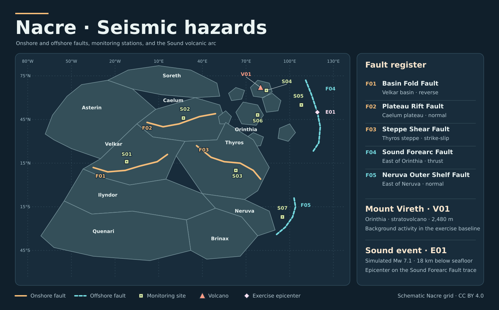

# Nacre seismic hazards

This extension maps five fictional fault traces, seven monitoring sites, one volcano, and the epicenter of a simulated offshore earthquake. The onshore traces cross the Velkar basin, Caelum plateau, and Thyros steppe. The offshore traces lie east of Orinthia and Neruva.

The editable SVG uses solid lines for onshore faults and dashed lines for offshore faults. IDs match the tables and Galaxy records. All positions use the shared fictional Nacre grid. Trace endpoints and station coordinates below are in decimal degrees, longitude first. The full trace vertices are in the [GeoJSON](../../geography/nacre.geojson).

## Fault register

| ID | Fault | Setting and region | Fault motion | Trace ends `[lon, lat]` |
|---|---|---|---|---|
| F01 | Basin Fold Fault | Onshore, Velkar Republic | Reverse | `[-35, 12]` to `[16, 21]` |
| F02 | Plateau Rift Fault | Onshore, Caelum Protectorate | Normal | `[2, 43]` to `[49, 49]` |
| F03 | Steppe Shear Fault | Onshore, Thyros Commonwealth | Strike-slip | `[36, 27]` to `[80, 4]` |
| F04 | Sound Forearc Fault | Offshore, east of Orinthia | Thrust | `[111, 72]` to `[116, 23]` |
| F05 | Neruva Outer Shelf Fault | Offshore, east of Neruva Federation | Normal | `[91, -34]` to `[103, -9]` |

The lines mark the modeled surface or seafloor traces. They show where faults appear in the exercise geography. Offshore country associations identify the nearest featured coast for coordination.

## Monitoring sites

| ID | Site | Setting | Coordinates `[lon, lat]` | Instrument and use |
|---|---|---|---|---|
| S01 | Velkar Basin Seismic Station | Onshore, Velkar Republic | `[-12, 16]` | Broadband seismometer for F01 |
| S02 | Mesa Seismic Station | Onshore, Caelum Protectorate | `[27, 46]` | Broadband seismometer for F02 |
| S03 | Steppe Seismic Station | Onshore, Thyros Commonwealth | `[63, 10]` | Broadband seismometer for F03 |
| S04 | Vireth Observatory | Onshore, Orinthia | `[84, 65]` | Seismometer, GNSS receiver, and gas sampler for V01 |
| S05 | Sound Shelf Seismometer | Offshore, east of Orinthia | `[108, 55]` | Ocean-bottom seismometer for F04 |
| S06 | Sound Harbor Tide Gauge | Onshore, Orinthia | `[77.9585, 48.1067]` | Water-level gauge at Sound Harbor |
| S07 | Delta Shelf Seismometer | Offshore, east of Neruva Federation | `[95, -22]` | Ocean-bottom seismometer for F05 |

Seismometers record ground motion. The harbor tide gauge records local water levels. The exercise uses both streams so participants can distinguish the earthquake report from observations on the shoreline.

## Mount Vireth

V01 is a stratovolcano in the Sound volcanic arc on a northern Orinthian island, at `[80, 67]`. Its modeled summit is 2,480 m above sea level. The exercise starts with background activity. Vireth Observatory compares seismic, deformation, and gas observations with that baseline.

## Exercise case · An offshore earthquake at Sound

The Sound offshore exercise earthquake (E01) occurs on the Sound Forearc Fault. The exercise bulletin gives a moment magnitude of Mw 7.1, an epicenter at `[119, 50]`, and a source depth of 18 km below the local seafloor. The Sound Shelf Seismometer reports shaking. The Sound Harbor Tide Gauge initially has no confirmed departure from its baseline, and Vireth Observatory reports background activity. A later tide-gauge report shows an unusual water-level oscillation. The exercise controller provides any official coastal advisory as a separate update.

**Participant task.** Prepare an initial situation report for Sound Harbor, the Sound Coastal Rescue Authority, and Sound Community Hospital. Then revise it when the tide-gauge report arrives. Identify who will issue the next update and record the time and source of each observation.

**Facilitator check.** The first report records the offshore earthquake and the current harbor and volcano observations separately. The second adds the observed water-level change and routes it to the rescue authority for coordination under its coastal emergency plan. The port confirms its operating status, the hospital reports reception readiness, and the incident lead tracks the official advisory separately from the observations.

## MISP Galaxy

Load the base Synthetic Exercise World and the [transport](../transport/README.md#misp-galaxy), [coast guard](../coast-guard/README.md#misp-galaxy), and [civil and humanitarian services](../civil-humanitarian/README.md#misp-galaxy) Galaxy files. Import the seismic hazards [Galaxy definition](galaxies/exercise-world-seismic.json) and [cluster collection](clusters/exercise-world-seismic.json) under type `exercise-world-seismic`.

| `meta.entity-type` | Relationships |
|---|---|
| `seismic-fault` | `observed-by` identifies the modeled seismic station. `meta.fault-motion` describes the fault. |
| `seismic-monitoring-site` | `monitors` identifies a fault or volcano. `hosted-at` links the tide gauge to Sound Harbor. `meta.instrument` lists the equipment. |
| `volcano` | `observed-by` links Vireth Observatory. `meta.activity-baseline` records the starting exercise condition. |
| `exercise-earthquake` | `models-source-on` identifies the fault. `seismic-observation-at` and `water-level-observation-at` identify the two observation sites. `exercise-coordination-with` links the port, rescue authority, and hospital. |

`located-in` references an onshore country and `near-country` references the named coast for offshore records. `meta.map-id` matches the map labels. `meta.geographic-feature-id` joins each record to its atlas feature. [Nacre geographic atlas](../../geography/README.md)

The map adapts the Nacre atlas under CC BY 4.0. [Original atlas](../../images/synthetic_exercise_world_clear_map.svg) · [License](../../LICENSE)
