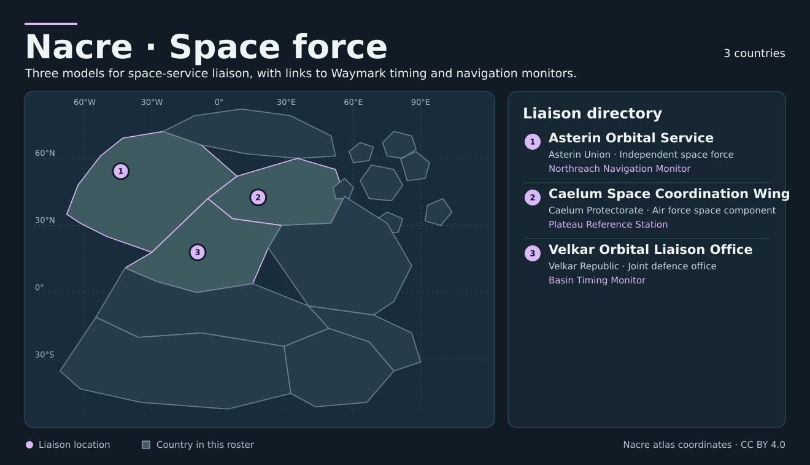

# Nacre space force

Three countries organize space-service liaison differently. Asterin has a distinct service, Caelum has an air force component, and Velkar uses a joint office. These desks exchange service status and timing observations with Waymark reference monitors.

## Country roster

| Country | Service | Organization | Liaison site | Exercise role |
|---|---|---|---|---|
| Asterin Union | Asterin Orbital Service | Independent space force | Northreach Navigation Monitor | Consolidates civilian timing service notices and reports local navigation observations. |
| Caelum Protectorate | Caelum Space Coordination Wing | Air force space component | Plateau Reference Station | Shares reference monitor status and consolidates plateau service advisories. |
| Velkar Republic | Velkar Orbital Liaison Office | Joint defence office | Basin Timing Monitor | Coordinates timing advisories and service reporting with the Basin monitor. |

Liaison points inherit the coordinates of their named hosts on the shared fictional grid. Highlighted countries have a service represented in this roster. [Nacre geographic atlas](../../geography/README.md)

## Exercise case · Timing reports disagree

The Northreach Navigation Monitor reports degraded timing quality. The Plateau Reference Station and Basin Timing Monitor report normal timing against their own local baselines. A shared notice draft currently marks the entire Waymark service as degraded.

**Participant task.** Compare observations by site and reporting window. Decide which desk consolidates the notice, label what the reports establish, and identify the update each monitor must provide next.

**Facilitator check.** The Asterin desk reports the local degradation. Caelum and Velkar share their own time-stamped observations. Publish a scoped status update that distinguishes Northreach from unaffected reporting sites and keeps a system-wide assessment pending.

## MISP Galaxy

Load the base Synthetic Exercise World and the linked records from [air force](../air-force/README.md#misp-galaxy) and [satellite navigation](../satellite-navigation/README.md#misp-galaxy). Import the [Galaxy definition](galaxies/exercise-world-space-force.json) and [cluster collection](clusters/exercise-world-space-force.json) under type `exercise-world-space-force`.

| Relationship | Meaning |
|---|---|
| `located-in` | References the service’s country in the base Galaxy. |
| `has-liaison-at` | References an existing host facility. The liaison point uses the host’s coordinates. |
| `coordinates-with` | References a civil or defense partner for the exercise role. |
| `part-of` | Identifies the parent service for a named component. |
| `liaises-with` | References the Waymark service for public navigation and timing status. |

The geographic feature ID matches the service cluster UUID. Base country references use the pinned [MISP Galaxy revision `779b780`](https://github.com/MISP/misp-galaxy/blob/779b780a13f67288d9b1a031b064fb140cdacaae/clusters/exercise-world.json).

The map adapts Nacre’s geography under CC BY 4.0. [Original atlas](../../images/synthetic_exercise_world_clear_map.svg) · [License](../../LICENSE)
