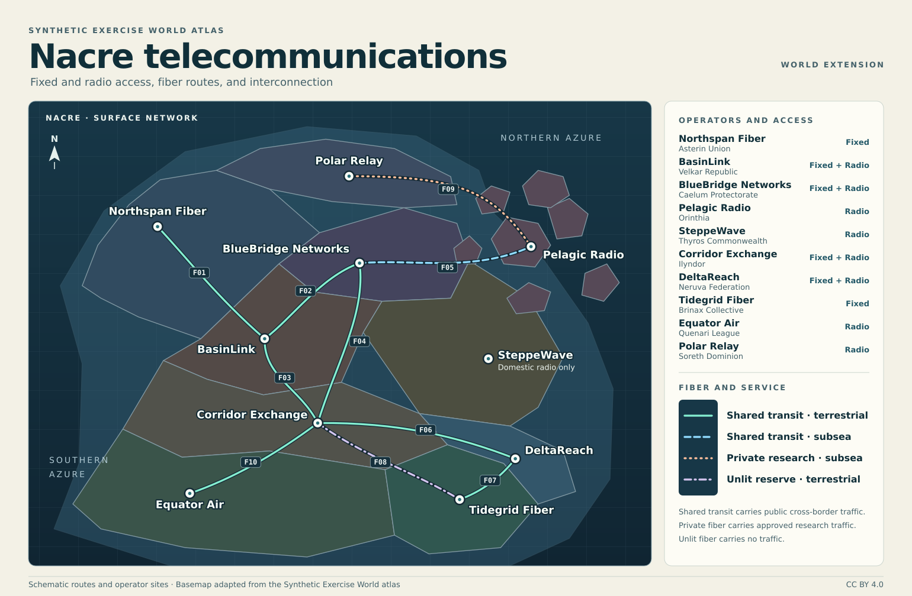

# Nacre telecommunications

This extension adds one representative telecom operator in each Nacre country. It models fixed broadband, radio access, cross-border fiber, and which operators exchange traffic over each link.

The editable SVG has separate basemap and telecom layers. The overlay shows operator hubs and schematic route paths. Read the operator key for subscriber access and the route labels for interconnection.

## Operators

| Country | Operator | Subscriber access | Cross-border service |
|---|---|---|---|
| Asterin Union | Northspan Fiber | Fixed | Shared transit to Velkar via F01 |
| Velkar Republic | BasinLink | Fixed and radio | Shared transit to Asterin, Caelum, and Ilyndor via F01, F02, and F03 |
| Caelum Protectorate | BlueBridge Networks | Fixed and radio | Shared transit to Velkar, Ilyndor, and Orinthia via F02, F04, and F05 |
| Orinthia | Pelagic Radio | Radio | Shared transit to Caelum via F05 and private research traffic to Soreth via F09 |
| Thyros Commonwealth | SteppeWave | Radio | Domestic-only network with local fiber backhaul |
| Ilyndor | Corridor Exchange | Fixed and radio | Shared transit to Velkar, Caelum, Neruva, and Quenari via F03, F04, F06, and F10 |
| Neruva Federation | DeltaReach | Fixed and radio | Shared transit to Ilyndor and Brinax via F06 and F07 |
| Brinax Collective | Tidegrid Fiber | Fixed | Shared transit to Neruva via F07. Unlit reserve to Ilyndor via F08 |
| Quenari League | Equator Air | Radio | Shared transit to Ilyndor via F10 |
| Soreth Dominion | Polar Relay | Radio | Private research traffic to Orinthia via F09. Domestic subscriber service |

Fixed access represents wired broadband. Radio access includes mobile or fixed-wireless service. A radio-only operator can still use fiber to connect towers, its domestic core, and any cross-border partners.

## Fiber and interconnection

| Route | Endpoints | Medium | Service |
|---|---|---|---|
| F01 · Iron Basin Trunk | Northspan Fiber ↔ BasinLink | Terrestrial | Shared transit |
| F02 · Plateau Trunk | BasinLink ↔ BlueBridge Networks | Terrestrial | Shared transit |
| F03 · Trade Corridor Spur | BasinLink ↔ Corridor Exchange | Terrestrial | Shared transit |
| F04 · Ridge Bypass | BlueBridge Networks ↔ Corridor Exchange | Terrestrial | Shared transit |
| F05 · Island Cable | BlueBridge Networks ↔ Pelagic Radio | Subsea | Shared transit |
| F06 · Delta Trunk | Corridor Exchange ↔ DeltaReach | Terrestrial | Shared transit |
| F07 · Coastal Link | DeltaReach ↔ Tidegrid Fiber | Terrestrial | Shared transit |
| F08 · Cooperative Reserve | Corridor Exchange ↔ Tidegrid Fiber | Terrestrial | Unlit reserve |
| F09 · Polar Research Cable | Pelagic Radio ↔ Polar Relay | Subsea | Private research traffic only |
| F10 · Orchard Spur | Corridor Exchange ↔ Equator Air | Terrestrial | Shared transit |

Shared transit carries public cross-border traffic in both directions for this exercise. Private traffic on F09 stays within the approved research network. F08 carries no traffic until both operators authorize and commission it. Domestic radio coverage can remain available when cross-border transit is lost.

## Exercise case · Two links down

A storm interrupts the Plateau Trunk (F02). Caelum and Velkar are still reachable through Ilyndor over the Ridge Bypass (F04) and Trade Corridor Spur (F03). The exercise assumes both links have enough capacity for priority traffic.

Thirty minutes later, Pelagic Radio reports loss of the Island Cable (F05). Local radio service in Orinthia remains available, and the separate F09 research circuit is still up. Public cross-border traffic and medical services that depend on it lose their mainland connection.

**Participant task.** Draw the paths that remain available, classify the outage by service, and draft a joint status notice explaining what domestic callers, research users, and mainland partners can still reach. Identify which operators need to coordinate restoration and how they would confirm that public transit has returned.

**Facilitator check.** The mainland detour uses F03 and F04. Orinthia has no remaining shared-transit path, even though F09 continues to carry private research traffic. F08 can only add an Ilyndor–Brinax path after commissioning, so it cannot restore Orinthia. SteppeWave’s domestic service is outside the affected transit network.

## MISP Galaxy

Load the base Synthetic Exercise World galaxy and cluster collection first, then import the extension's [Galaxy definition](galaxies/exercise-world-telecom.json) and [cluster collection](clusters/exercise-world-telecom.json). Use the galaxy type `exercise-world-telecom`.

Operators link to their base country UUIDs with `operates-in`. The BlueBridge Networks operator record also links to the existing company with `models-role-of`. Each fiber route links to its two operators with `terminated-by`, and operators link back with `terminates`. These associations describe physical endpoints. Use `meta.service-state` on fiber records to build a traffic graph. For shared transit, only include `shared-transit` routes. Operators describe subscriber access in `meta.access-networks`.

The country and company UUIDs were verified against [MISP Galaxy revision `779b780`](https://github.com/MISP/misp-galaxy/blob/779b780a13f67288d9b1a031b064fb140cdacaae/clusters/exercise-world.json).

The map uses recolored country outlines from the Synthetic Exercise World atlas and adds the telecom overlay. The extension is licensed under CC BY 4.0. [Original atlas](../../images/synthetic_exercise_world_clear_map.svg) · [License](../../LICENSE)
