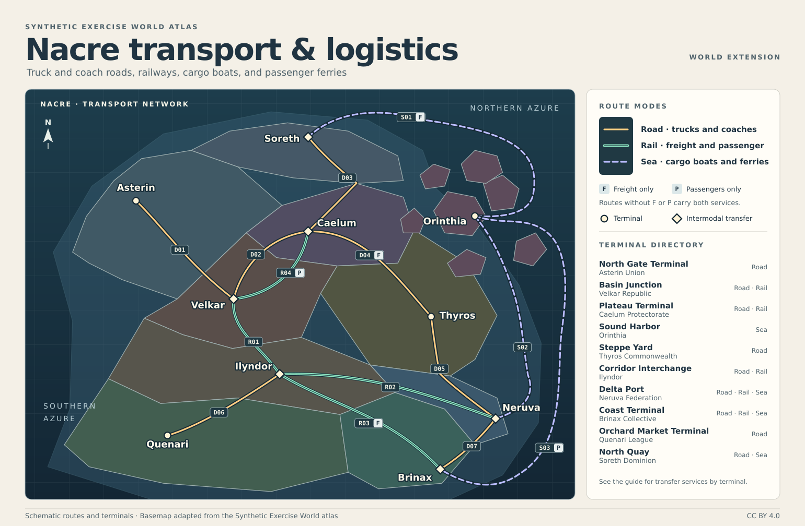

# Nacre transport and logistics

This extension adds ten terminals across Nacre and fourteen routes for trucks and coaches, freight and passenger trains, coastal cargo boats, and ferries.

The editable SVG separates the basemap, roads, railways, sea routes, and terminals into layers. Route IDs match the tables and Galaxy records. **F** marks freight-only routes, **P** marks passenger-only routes, and unmarked routes carry both. Diamonds indicate a change of mode for at least one service. The routes and terminal locations are schematic.

## Terminals and transfers

Use the freight and passenger columns separately when planning a transfer. Brinax Coast Terminal, for example, can transfer pallets between trucks and trains and passengers between ferries and coaches.

| Country | Terminal | Freight modes | Passenger modes |
|---|---|---|---|
| Asterin Union | North Gate Terminal | Road | Road |
| Velkar Republic | Basin Junction | Road, rail | Road, rail |
| Caelum Protectorate | Plateau Terminal | Road | Road, rail |
| Orinthia | Sound Harbor | Sea | Sea |
| Thyros Commonwealth | Steppe Yard | Road | Road |
| Ilyndor | Corridor Interchange | Road, rail | Road, rail |
| Neruva Federation | Delta Port | Road, rail, sea | Road, rail, sea |
| Brinax Collective | Coast Terminal | Road, rail | Road, sea |
| Quenari League | Orchard Market Terminal | Road | Road |
| Soreth Dominion | North Quay | Road, sea | Road |

## Routes

All routes run in both directions in the exercise baseline. Road entries model truck and coach services. Rail entries model freight trains and scheduled passenger trains. The Azure Ro-Pax Route carries rolling cargo and passengers on the same ferry. The Brinax Island Ferry carries foot passengers.

| Route | Terminals | Mode | Service |
|---|---|---|---|
| D01 · Northern Highway | North Gate Terminal ↔ Basin Junction | Road | Freight and passengers |
| D02 · Plateau Highway | Basin Junction ↔ Plateau Terminal | Road | Freight and passengers |
| D03 · Polar Pass | Plateau Terminal ↔ North Quay | Road | Freight and passengers |
| D04 · Steppe Haul Road | Plateau Terminal ↔ Steppe Yard | Road | Freight only |
| D05 · Delta Highway | Steppe Yard ↔ Delta Port | Road | Freight and passengers |
| D06 · Orchard Road | Corridor Interchange ↔ Orchard Market Terminal | Road | Freight and passengers |
| D07 · Coast Highway | Coast Terminal ↔ Delta Port | Road | Freight and passengers |
| R01 · Basin Main Line | Basin Junction ↔ Corridor Interchange | Rail | Freight and passengers |
| R02 · Corridor–Delta Railway | Corridor Interchange ↔ Delta Port | Rail | Freight and passengers |
| R03 · Brinax Freight Line | Corridor Interchange ↔ Coast Terminal | Rail | Freight only |
| R04 · Plateau Express | Basin Junction ↔ Plateau Terminal | Rail | Passengers only |
| S01 · Northern Supply Run | North Quay ↔ Sound Harbor | Sea | Freight only |
| S02 · Azure Ro-Pax Route | Sound Harbor ↔ Delta Port | Sea | Freight and passengers |
| S03 · Brinax Island Ferry | Sound Harbor ↔ Coast Terminal | Sea | Passengers only |

## Exercise case · A ferry berth closes

A storm damages the roll-on/roll-off berth at Neruva's Delta Port. The port suspends S02 while the passenger station and rail yard remain open. At Sound Harbor in Orinthia, 160 passengers and 30 pallets of essential supplies are waiting for transport to Neruva.

The next Brinax passenger ferry (S03) and its connecting coaches (D07) each have 180 seats. The next Northern Supply Run (S01) has room for 24 pallets. Assume the onward road and rail services listed for the case have space for those 24 pallets in the exercise window.

**Participant task.** Assign the passengers and pallets to routes, identify the transfer terminals, and tell each terminal what to expect. After an icy stretch closes the Steppe Haul Road (D04), revise the freight plan and identify how many pallets must wait at Sound Harbor.

**Facilitator check.** Send all 160 passengers to Brinax on S03, then to Neruva by coach on D07. Send 24 pallets to Soreth on S01 and transfer them to trucks at North Quay for D03. Before D04 closes, trucks can continue to Neruva via D04 and D05. After it closes, send the pallets on D02 to Basin Junction in Velkar, transfer them to a freight train on R01, and continue on R02 to Neruva via Ilyndor. Keep six pallets at Sound Harbor for a later sailing and record them separately from the freight already dispatched.

## MISP Galaxy

Load the base Synthetic Exercise World galaxy and cluster collection first, then import the transport [Galaxy definition](galaxies/exercise-world-transport.json) and [cluster collection](clusters/exercise-world-transport.json). Use galaxy type `exercise-world-transport`.

Terminals use `meta.freight-modes` and `meta.passenger-modes` to describe the modes available for each service. Each terminal is `located-in` a base country by UUID and `terminates` its routes. Routes use `meta.route-id`, `meta.transport-mode`, `meta.services`, and `meta.vehicle-service`, and each is `terminated-by` two terminal UUIDs. To build an itinerary, filter routes by the service, then join routes at terminals that support the relevant mode changes.

The country UUIDs were verified against [MISP Galaxy revision `779b780`](https://github.com/MISP/misp-galaxy/blob/779b780a13f67288d9b1a031b064fb140cdacaae/clusters/exercise-world.json).

The map uses recolored country outlines from the Synthetic Exercise World atlas and adds the transport layers. The extension is licensed under CC BY 4.0. [Original atlas](../../images/synthetic_exercise_world_clear_map.svg) · [License](../../LICENSE)
