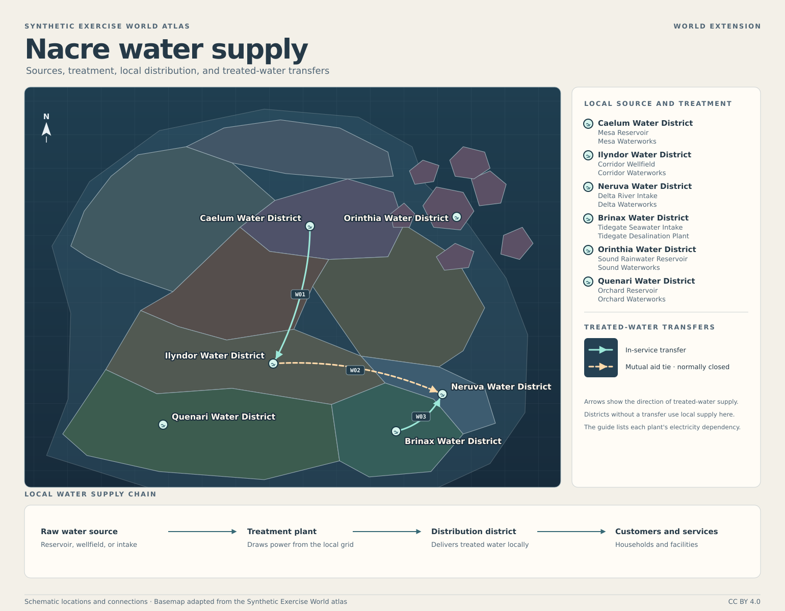

# Nacre water supply

This extension models six representative districts in Caelum, Ilyndor, Neruva, Brinax, Orinthia, and Quenari. It follows water from raw sources through treatment into local distribution and shows three cross-border transfers of treated water. Each treatment plant links to the [electricity extension](../electricity/README.md).

The editable SVG separates the basemap, water districts, transfers, and local supply chain. District markers represent the local supply system. Site locations and routes are schematic.

## Local supply chains

| Country | Raw source | Treatment plant | Local distribution | Electricity supply |
|---|---|---|---|---|
| Caelum Protectorate | Mesa Reservoir | Mesa Waterworks | Caelum Water District | Caelum Distribution Area |
| Ilyndor | Corridor Wellfield | Corridor Waterworks | Ilyndor Water District | Ilyndor Distribution Area |
| Neruva Federation | Delta River Intake | Delta Waterworks | Neruva Water District | Neruva Distribution Area |
| Brinax Collective | Tidegate Seawater Intake | Tidegate Desalination Plant | Brinax Water District | Brinax Distribution Area |
| Orinthia | Sound Rainwater Reservoir | Sound Waterworks | Orinthia Water District | Orinthia Distribution Area |
| Quenari League | Orchard Reservoir | Orchard Waterworks | Quenari Water District | Quenari Distribution Area |

Plants treat raw water before it reaches the district mains. Each district represents local distribution to residents, businesses, and public services. Orinthia and Quenari use local supply in the modeled network.

## Treated-water transfers

| Transfer | Direction | Baseline |
|---|---|---|
| W01 · Plateau Treated-Water Main | Caelum → Ilyndor | In service |
| W02 · Delta Mutual Aid Tie | Ilyndor → Neruva | Normally closed |
| W03 · Coastal Treated-Water Main | Brinax → Neruva | In service |

The arrows show the modeled direction of treated-water supply. A normally closed tie carries water after the participating utilities authorize the transfer and confirm that both systems can receive or deliver the agreed supply.

## Exercise case · Delta Waterworks loses power

An interruption on the local feeder stops treatment at Delta Waterworks. Neruva's district mains and transfer connections remain available. The Brinax utility can send 26 units of treated water over W03 during the exercise window. Ilyndor offers another 14 units over W02, subject to joint approval and quality confirmation. These offers account for each supplying district's own needs.

Neruva has 36 units of priority demand and normally uses 80 units during the same window. Use the units as a tabletop allocation measure.

**Participant task.** Trace the available supply and calculate the priority shortfall before W02 opens. Decide which utilities confirm the mutual-aid transfer and how they report the supply available for other customers.

**Facilitator check.** W03 leaves 10 units of priority demand unmet. Once W02 is authorized and available, the combined 40 units cover the 36 priority units and leave four units for other demand. Delta Waterworks returns as a local source after its operator confirms that power and treated-water quality are restored.

## MISP Galaxy

Load the base Synthetic Exercise World and the [electricity Galaxy files](../electricity/README.md#misp-galaxy), then import the water supply [Galaxy definition](galaxies/exercise-world-water-supply.json) and [cluster collection](clusters/exercise-world-water-supply.json). Use galaxy type `exercise-world-water-supply`.

| `meta.entity-type` | Relationships |
|---|---|
| `water-source` | `supplies-raw-water-to` identifies the treatment plant. |
| `water-treatment-plant` | `treats-water-from` links the raw source. `supplies-treated-water-to` links the district. `draws-power-from` points to an existing electricity distribution area. |
| `water-distribution-district` | `receives-treated-water-from` links the local plant. `exports-via` and `imports-via` link any modeled transfers. |
| `treated-water-transfer` | `originates-at` and `supplies` give the direction between districts. `meta.route-id` matches the map and `meta.transfer-state` records the baseline. |

The local records reference base countries by UUID. [MISP Galaxy revision `779b780`](https://github.com/MISP/misp-galaxy/blob/779b780a13f67288d9b1a031b064fb140cdacaae/clusters/exercise-world.json)

The map adapts the Nacre atlas under CC BY 4.0. [Original atlas](../../images/synthetic_exercise_world_clear_map.svg) · [License](../../LICENSE)
