# Run a Nacre exercise in MISP

Use this walkthrough to load the Synthetic Exercise World Galaxy, build a synthetic incident record, and exchange reviewed findings across separate MISP instances. It uses **NACRE-01 · Delta Port dispatch delay** as a worked example. A single instance is enough for the event, report, and assessment walkthrough. The federation steps add independent teams and a receiving-side verification exercise.

The instructions were checked against MISP application revision `cd8a4f4`. The screenshots show the MISP interface with MISP Book training data. Use the Nacre names and values from the walkthrough when following them. [Checked application revision](https://github.com/MISP/MISP/commit/cd8a4f416438174389d57307894039ce0c75f6c9)

For a second walkthrough focused on defender decisions and indicator sharing, use the [NACRE-02 telecom exercise](telecom-defence.md).

## Prepare the exercise environment

1. Set up a dedicated MISP instance for each participating team and one for Exercise Control. Give each instance its own database, Redis, files, credentials, and HTTPS base URL. Use separate hosts or isolated Compose deployments with distinct ports and storage. Use certificates trusted by the exercise instances. [MISP Book Docker quick start](https://www.circl.lu/doc/misp/quick-start/)
2. If you use Docker, pin the same application `CORE_COMMIT` on each instance. Record the application, deployment, exercise-repository, and Galaxy revisions in the facilitator's run sheet. Use a unique local host organisation and keep a roster of its UUID, instance URL, and facilitator contact. [Docker source used for the walkthrough](https://github.com/MISP/misp-docker/tree/misp-3.0_wip)
3. Give exercise authors permission to create and edit their organisation's events, attach tags and Galaxy clusters, and create Analyst Data. Give publication permission to the designated reviewer. Use separate Sync user accounts for instance-to-instance sharing and leave production peers, feeds, email notifications, and downstream detection integrations outside the exercise.
4. Use the same fictitious country names and incident ID in all handovers. Give defenders the public brief and keep the later injects with Exercise Control. Start with manually triggered sync so the facilitator can see who received each item.

## Load the Nacre Galaxy and clusters

MISP loads a Galaxy definition from `galaxies/` and its cluster collection from `clusters/`. Install both files on every peer. NACRE-01 uses the base `exercise-world` pair and the `exercise-world-transport` extension. Other extensions can be added using the dependencies in their individual guides. Keep the original UUIDs and use the same catalog revisions on all teams' instances. [World extensions](../README.md#world-extensions)

For the official Docker setup, run this from the Compose directory on each exercise host. Set `sewf` to the absolute path of the checked-out Synthetic Exercise World repository on that host.

```bash
sewf=/path/to/Synthetic-Exercise-World-Format
base_rev=779b780a13f67288d9b1a031b064fb140cdacaae
upstream=https://raw.githubusercontent.com/MISP/misp-galaxy
catalog=$(mktemp -d)
galaxy_dir=/var/www/MISP/app/files/misp-galaxy

for kind in galaxies clusters; do
  mkdir -p "$catalog/$kind"
  curl --fail --silent --show-error --location \
    "$upstream/$base_rev/$kind/exercise-world.json" \
    --output "$catalog/$kind/exercise-world.json" || exit 1
  cp "$sewf/extensions/transport/$kind/exercise-world-transport.json" \
    "$catalog/$kind/" || exit 1
  for file in "$catalog/$kind/"*.json; do
    docker compose cp "$file" "misp-core:$galaxy_dir/$kind/" || exit 1
  done
done

docker compose exec -T --user www-data misp-core \
  /var/www/MISP/app/Console/cake Admin updateGalaxies
```

For other deployments, stage the same pairs under the instance's `app/files/misp-galaxy/` and run `cake Admin updateGalaxies` as the MISP service user, or use **Update Galaxies** in the admin interface. Check the staged files after a container rebuild or catalog refresh. If the database already holds a newer version, agree on a common catalog version across peers and verify the expected entries. The standard update follows version rules. Keep the build revisions with your exercise notes. [Galaxy loading and version handling](https://www.circl.lu/doc/misp/galaxy/#galaxy-definition-updates)

Open **Data models → Galaxies**. Find **Synthetic Exercise World** and verify that the pinned base catalog contains 60 entries, including **Neruva Federation**, **Velkar Republic**, and **TA-701 Silver Mantis**. Open the transport Galaxy and look for **Delta Port**, **Coast Terminal**, and **Sound Harbor**. If the picker later omits a cluster, check that the paired files were loaded and the Galaxy is enabled.

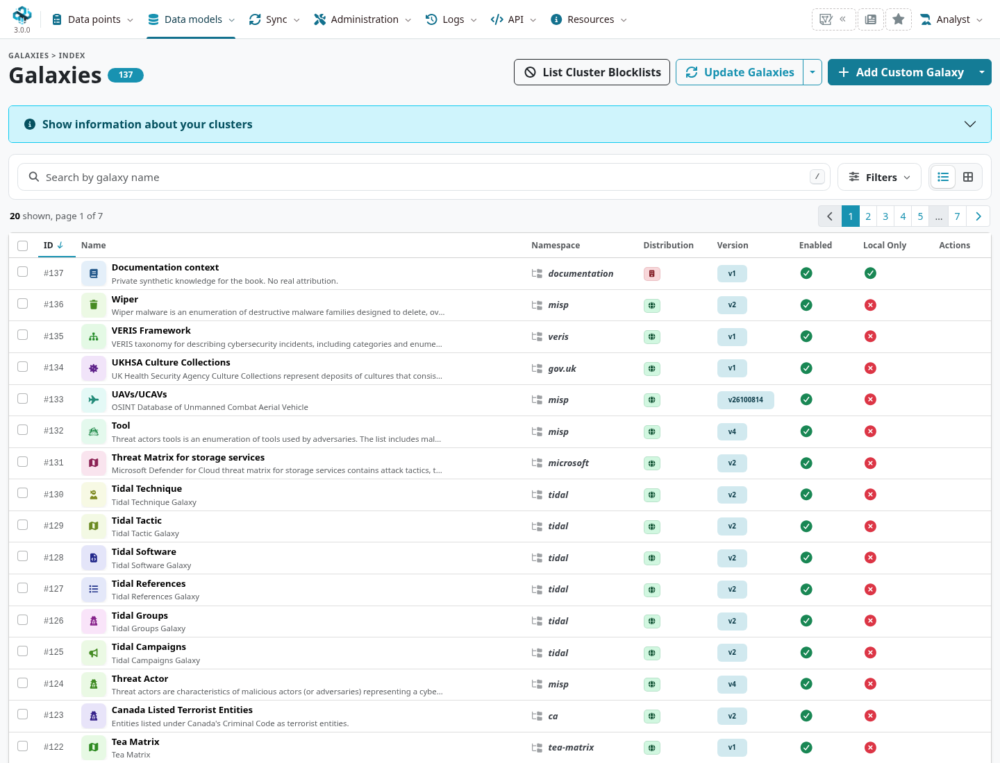

## Create the synthetic event

On the Exercise Control instance, open **Data points → Events → Add Event**. Use **[EXERCISE] NACRE-01 · Delta Port dispatch delay** as the event title. Set the event date to **2026-11-18** for the worked example, **Analysis level** to **Initial**, **Threat level** to **Undefined**, and **Distribution** to **Your organisation only**. Leave it unpublished while preparing the evidence and report. Record the saved event UUID.

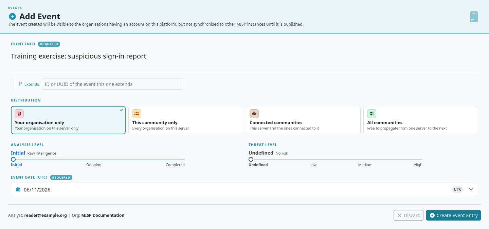

In the event's **Attributes** tab, add these two entries under **Network activity**. Choose **Inherit event** and leave **For IDS** off for both. The values come from the reserved `.example` domain and the documentation address block.

| Type | Value | Observation comment |
|---|---|---|
| `domain` | `dispatch.delta-port.example` | Synthetic dispatch log, 2026-11-18 09:05 UTC |
| `ip-dst` | `192.0.2.44` | Simulated destination in the same exercise log |

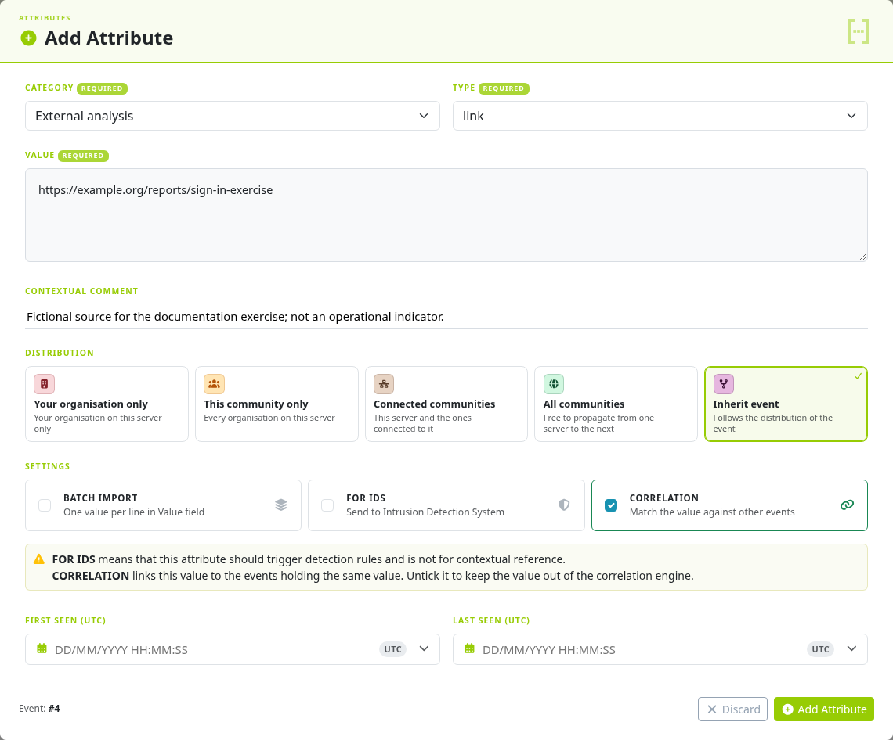

To use a ready-made starting event, open **API → REST client**, select **POST**, and enter `/events/add`. Set the request format to JSON, use an API key for an authorised Exercise Control author, and paste the [NACRE-01 JSON](examples/nacre-01-event.json) into the request editor. Choose this path or create the event manually. The fixture's event and attribute UUIDs are fixed for one run. Use fresh UUIDs when seeding a separate run in the same database. Confirm that the response lists both attributes, reports no validation errors, and leaves the event unpublished and organisation-only. [MISP event API](https://www.circl.lu/doc/misp/automation/#api-create-event)

Open the event's context or Galaxy controls and use the cluster picker to attach **Neruva Federation** and **Delta Port**. Inspect the selected values before saving. In this exercise, set the attachment scope to **global** for context you intend to travel with the released event. The draft's event distribution still controls its audience. Team-only analytic tags can stay local. Keep the actor name in the assessment as a scenario hypothesis and use Galaxy tags to record the confirmed country and site context.

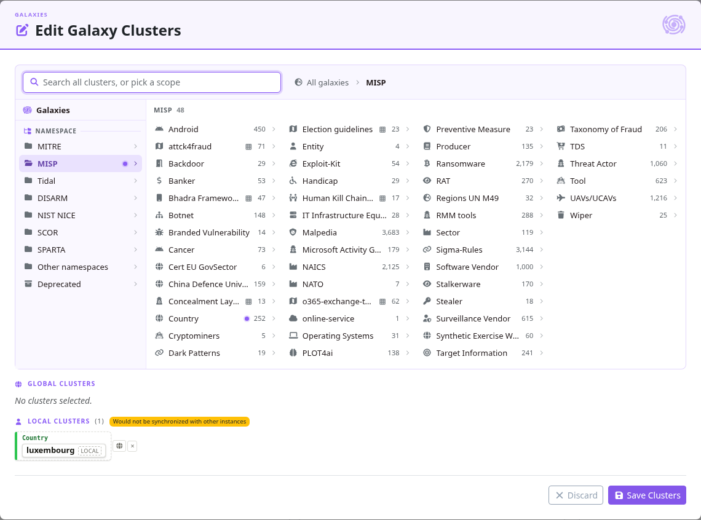

## Write and review the event report

From the event's **Reports** tab, choose **Write a report** or **Add report**. Use the title **NACRE-01 · Initial situation report** and set **Distribution** to **Inherit event**. Use this structure in the Markdown editor.

```markdown
## Observed
At 09:05 UTC, the simulated Delta Port dispatch queue stopped advancing.
Source is the exercise dispatch log.

## Assessment
Port dispatch is degraded. The cause is undetermined.
The facilitator supplied an unconfirmed TA-701 Silver Mantis hypothesis.

## Action and next update
Neruva will check the local dispatch record and confirm the berth status.
Exercise Control will check with Brinax and Orinthia before the 09:30 UTC update.
```

Use **Edit Content** and the element controls to insert a live reference to the domain attribute in **Observed**. A manually written reference has the form `@[attribute](UUID)` with the attribute UUID from this instance's saved event. Select **Save** and open **General** to verify that the reference resolves and the report states its evidence, uncertainty, and next action. Check distribution before publishing and verify the rendered report on the receiving instance. Readers need access to referenced records. [MISP event report documentation](https://www.circl.lu/doc/misp/event-reports/)

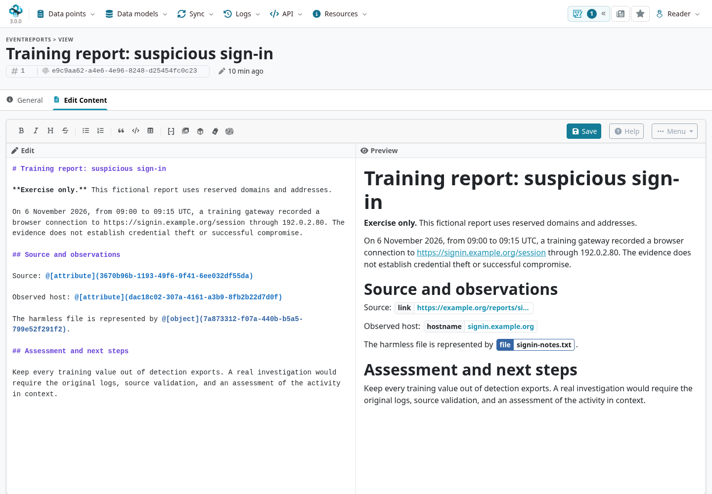

## Record analyst data and publish

Open the event's **General → Assessment** card. The add control exposes the annotation types permitted by your role. Start with **Your organisation only** for each annotation. Analyst Data has its own distribution, so choose the intended audience separately before a handover.

| Annotation | What to create |
|---|---|
| **Note** | Attach a note to the initial event or report. Record that the source is an exercise log and that the observed queue delay leaves several possible explanations. |
| **Opinion** | Attach a **50 (Neutral)** opinion to the initial report. Explain that the report is plausible and the scenario hypothesis lacks corroboration. |
| **Relationship** | Once the Neruva team creates its response event, add a directed `derived-from` relationship from that event to the Exercise Control event by UUID and choose **Event** as the target type. |

Use the relevant attribute's **Sighting details** control if a team receives an independent synthetic observation of the same domain. Record its time and source with the occurrence. The sighting records an observation, while the report and its annotations carry the team's interpretation. [MISP Analyst Data documentation](https://www.circl.lu/doc/misp/analyst-data/)

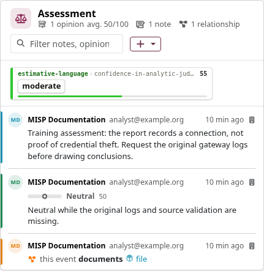

Before sending the event, have the reviewer check the two attributes, attached clusters, report references, and each record's audience. On a single instance, publish the reviewed event with **Your organisation only** and notifications off. For team exchange, first complete the [release pilot](#set-the-rules-and-run-a-release-pilot) below. Then change the event to the approved sharing group, set the report to **Inherit event** if it goes to the same recipients, and review the audience of each analyst record. Select **Publish** with notifications off and verify receipt. A draft's privacy depends on its distribution. [MISP publication and review](https://www.circl.lu/doc/misp/using-the-system/#publish-an-event)

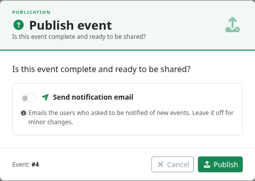

## Run the exercise across separate instances

In this round the facilitator selects **Neruva Federation** as the target and asks the Velkar scenario cell to draft adversary-side injects for Exercise Control. These are fictional observations and timed messages. The defenders use MISP to build and share an evidence-based picture and coordinate service continuity.

| Instance and host organisation | Exercise assignment | What the team produces |
|---|---|---|
| **Ilyndor Control** | Own the scenario and release each inject to its intended recipients. | Initial event, audience register, and final timeline |
| **Neruva Defenders** | Assess the Delta Port disruption and coordinate the local response. | Evidence notes and a port operations update |
| **Brinax Defenders** | Defend Coast Terminal operations and assess whether a receiving berth is available. | A capacity and readiness report |
| **Orinthia Defenders** | Defend Sound Harbor operations and account for delayed sailings. | An independent dispatch or sailing status report |
| **Velkar Scenario Cell** | Plan fictional injects about the selected target and propose what each team would observe. | Draft inject reports for the facilitator's review |

Control can collect inject drafts in a separate MISP instance for the scenario cell, or through a facilitator-only exchange. Keep this review channel separate from the defender peers. Use the transport map to see why the teams need different reports. In this round the Azure Ro-Pax route connects Sound Harbor and Delta Port, and the Brinax Island Ferry connects Sound Harbor and Coast Terminal. [Transport and logistics extension](../extensions/transport/README.md)

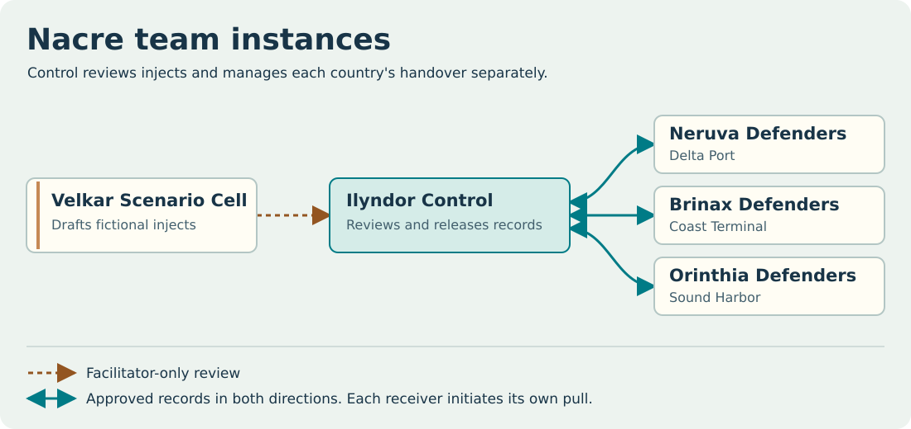

### Prepare an adversary-side inject

On the Velkar instance, create the organisation-only draft **[EXERCISE] NACRE-01 · Inject 01**. Attach **Neruva Federation** and **Delta Port** as the target context. In its report, give Control the planned release time, the intended recipient, the fictional observation, and the decision you want to exercise. For the initial inject, use **09:05 UTC**, **Neruva Defenders**, and **the dispatch queue stopped advancing**. The decision is whether the team can verify the interruption and continue port operations while attribution remains uncertain. Keep facilitator notes and the adjudication criteria in the review channel. Control releases the approved observation through the initial event.

For a different round, choose another country and an existing facility from its Galaxy and extension map. Update the target tags, scenario observations, receiving group, and expected response together. Record any fictional actor claim as a hypothesis in the recipient brief.

### Set up one pull, then repeat for each country

For **Neruva to pull reviewed injects from Control**:

1. On **Control**, create or identify a local organisation record representing **Neruva Defenders**, using its UUID from the Neruva instance. Create a dedicated **Sync user** in that organisation and issue a scoped API key for this peer.
2. On **Neruva**, a site administrator opens **Sync → Servers & Feeds → Servers → Add Server**. Enter Control's HTTPS base URL, select **Ilyndor Control** as the organisation hosting the remote instance, and use the key issued by **Control**. The host-organisation UUID and the remote key's account organisation represent different identities.
3. Under **What to synchronise**, enable **Pull** for **Events**. Enable **Pull** for **Analyst data** only for a pilot that explicitly includes approved annotations. Leave **Push**, remote value caching, and the remaining data types off for this connection. The Nacre default Galaxy catalog is already loaded on both instances.

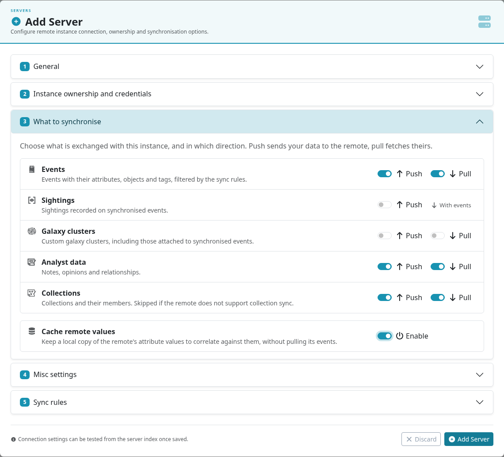

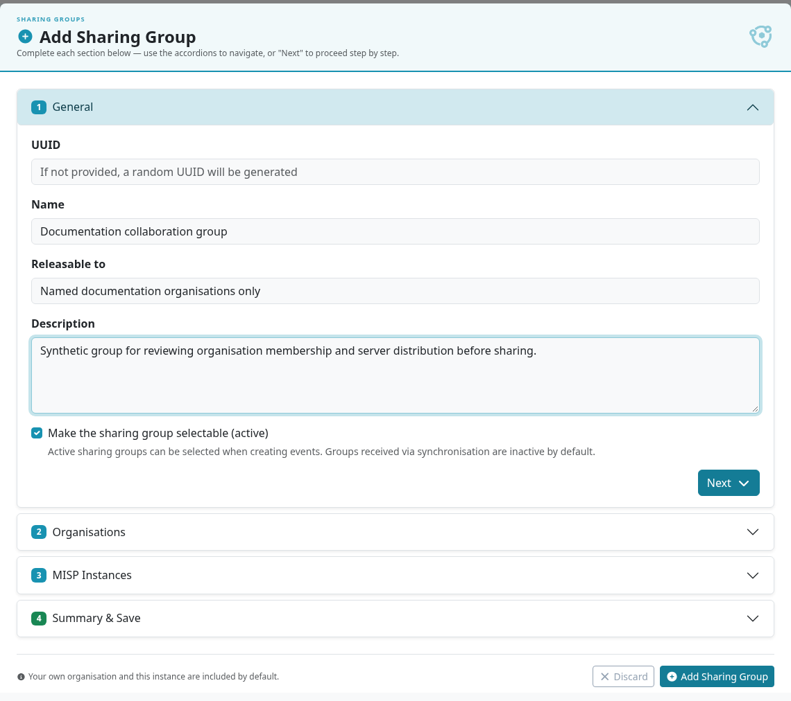

For **Control to pull Neruva's approved responses**, reverse source and receiver. Issue a different key on **Neruva** to a **Sync user** representing **Ilyndor Control**, and configure a peer on **Control** pointed at the **Neruva** host organisation. Repeat the same pattern for Brinax and Orinthia using separate credentials and peers. [MISP synchronisation and account identities](https://www.circl.lu/doc/misp/sharing/#concept)

After the peer records exist, open **Sync → Sharing Groups → List Sharing Groups** on each source. Create an active group for that handover. For the Control-to-Neruva group, include **Ilyndor Control** and **Neruva Defenders** and their corresponding servers. Keep **All organisations** off for those servers. Set the group's membership before selecting it as an event's distribution, review roaming and extender settings, and verify access with an ordinary recipient account. Use separate groups for other countries. [MISP sharing group setup](https://www.circl.lu/doc/misp/using-the-system/#create-and-manage-sharing-groups)

### Set the rules and run a release pilot

1. Create agreed global event tags on the exercise instances. This run uses `nacre-01:handover="approved"` and `nacre-01:handover="hold"`. Record both as exercise workflow labels. The sharing group defines audience and the tags narrow candidacy for this pull.
2. In the receiving server entry's **Pull rules**, allow the approved tag, block the hold tag, and allow the source host organisation by UUID. Save the rules. Keep scheduled pulls paused while testing. [MISP pull rules](https://www.circl.lu/doc/misp/first-synchronization/#pull-rules-and-time-windows)
3. On the source, prepare a shareable pilot with the approved tag and matching sharing group. Also create a published synthetic control record with the same group and both tags to test the block rule. Keep a third draft organisation-only. Use a separate pairwise group when testing whether another country is excluded.
4. Use **Test connection**, then **Test Pull Rules** from the server list. Confirm the candidate set and select **Pull all** on the receiver to exercise the saved rules. Check the job and compare actual event UUIDs, creator organisation, distribution, global tags and Galaxy attachments, report links, and any enabled Analyst Data. Verify that the held record and private draft stay out of the receiving instance.
5. Open the result as an ordinary recipient and check that the group covers the intended readers. Repeat the positive and negative checks for every direction and country before running a timed round. If an annotation is missing, check its own distribution and the peer's **Analyst data** switch in addition to the parent event's result. [MISP pilot procedure](https://www.circl.lu/doc/misp/first-synchronization/#test-the-rules-and-run-a-pilot)

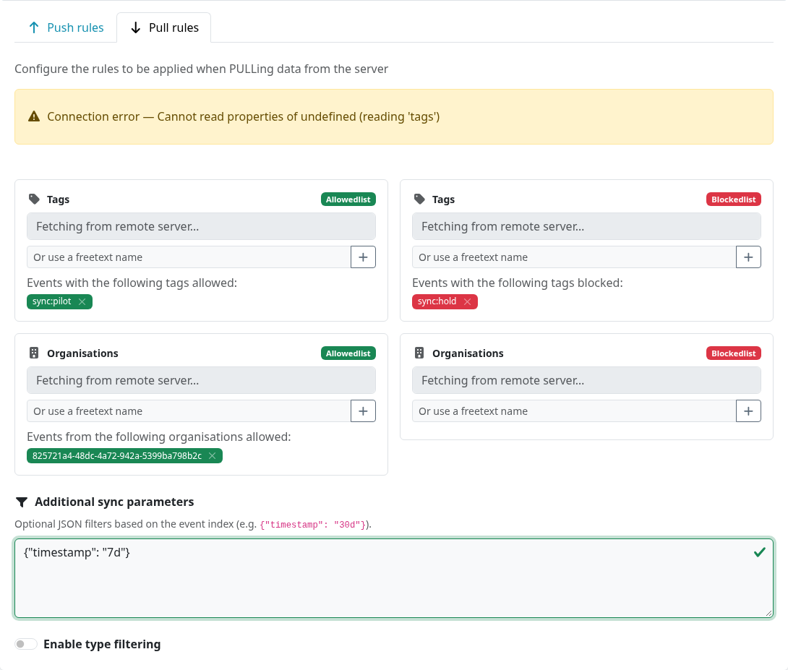

For each approved inject or response, select the intended sharing group, apply the approved tag, and clear any hold tag as part of review. Publish the reviewed version and have the recipient run **Pull all** on the saved peer. Record the event UUID, intended audience, and receipt confirmation in Control's handover log.

For an exercise without server sync, have Control share a reviewed **MISP JSON** event export through the agreed exercise channel. On the recipient, review the import audience and publication settings before uploading the export. Confirm the event UUID, creator, fields, and locks after import. Use the locally authored **POST `/events/add`** fixture only to seed the original exercise event. [MISP event exports](https://www.circl.lu/doc/misp/using-the-system/#exporting-data)

### Run the round and debrief

| Exercise time | Facilitator releases | Expected response |
|---|---|---|
| **09:05 UTC** | Delta Port dispatch queues stop advancing. Give the two synthetic log values to Neruva. | Neruva records the observation, opens a response, and separates impact from the unconfirmed actor hypothesis. |
| **09:20 UTC** | Brinax receives a request for an alternate berth. Orinthia receives a synthetic delayed manifest. | Each team records its own observation and sends a narrow update to Control with the incident ID. |
| **09:30 UTC** | A maintenance record offers a second explanation for the initial queue interruption. | Teams reassess their opinions, update the reports, and explain which assessments changed and why. |
| **09:45 UTC** | Control closes the round and compares the expected and received records. | Teams hand in their event and report UUIDs, evidence, remaining uncertainty, and recipient verification. |

On each defender instance, create a locally owned response event. Enter the Control event UUID in **Extends** if the parent event is accessible to the response's intended readers. For a standalone response, put the incident ID in the title and use the directed Analyst Data relationship where the target is visible. Use a short report with local findings, the action taken, and the next update. Publish it through the reviewed group for Control. The facilitator can prepare a separate shared summary for the other countries. [MISP extended events](https://www.circl.lu/doc/misp/extended-events/)

In the debrief, check four outcomes. Defenders distinguished observations from hypotheses, separate teams kept their creator identities, the right recipients got each approved item, and the hold and private cases stayed within their intended audiences. Compare the first and final reports to see how the additional evidence changed the assessment. Keep approved exercise artifacts according to the exercise's retention plan, then pause temporary sync and retire the exercise keys.

## Screenshot provenance

The unmodified screenshots use standalone MISP Book training data. The MISP Book contributors license these screenshots under CC BY-SA 4.0. The source tree below pins the exact images, and its capture records document the application commits and UI fixtures. [MISP Book screenshot sources](https://github.com/MISP/misp-book/tree/b675fdc9e3926490bd104a3280e2344c10269b8f) · [CC BY-SA 4.0](https://creativecommons.org/licenses/by-sa/4.0/)

- Galaxy catalogue and picker. [Data-model capture record](https://github.com/MISP/misp-book/blob/b675fdc9e3926490bd104a3280e2344c10269b8f/assets/data-model-screenshots.json)
- Event, attribute, report, Assessment, publication, and sharing group screens. [Using MISP capture record](https://github.com/MISP/misp-book/blob/b675fdc9e3926490bd104a3280e2344c10269b8f/assets/using-misp-screenshots.json)
- Server sync controls and Pull rules. [Sharing capture record](https://github.com/MISP/misp-book/blob/b675fdc9e3926490bd104a3280e2344c10269b8f/assets/sharing-screenshots.json) · [Pilot capture record](https://github.com/MISP/misp-book/blob/b675fdc9e3926490bd104a3280e2344c10269b8f/assets/first-synchronization-screenshots.json)
