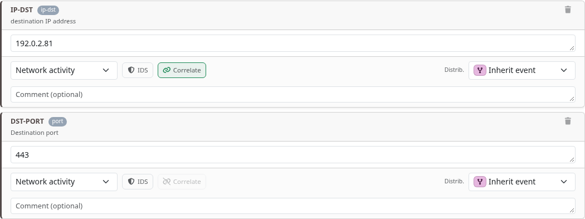
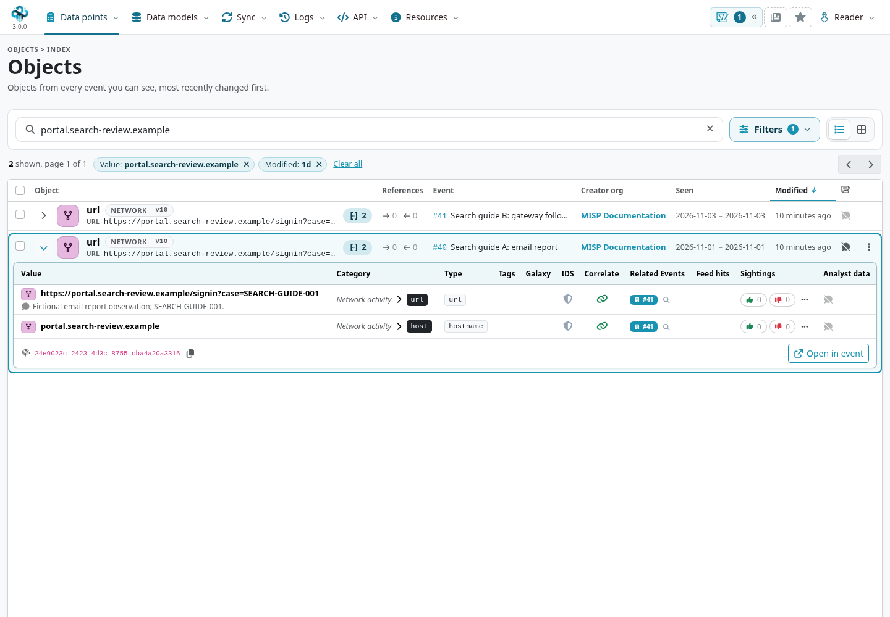

# Protect Nacre telecom services with shared indicators

**NACRE-02 · DeltaReach indicator handover** is a 60-minute defender exercise in MISP. One telecom operator shares two candidate indicators of compromise (IoCs). Its partners stage narrow protections, test them against simulated observations, and handle a correction without interrupting legitimate service. The exercise uses reserved domains and documentation IP addresses. Use the supplied replay CSV to simulate decisions in a spreadsheet or an offline test harness.

## Set up the teams and the network

| Team | Nacre infrastructure | Exercise task |
|---|---|---|
| **DeltaReach · Neruva Federation** | Delta Trunk (F06) to Ilyndor and Coastal Link (F07) to Brinax | Author the event, review the two indicators, and correct the guidance when new evidence arrives. |
| **Corridor Exchange · Ilyndor** | Shared transit to Neruva on F06 | Stage a temporary exact-URL protection for the exercise web gateway. Verify that ordinary service checks still pass. |
| **Tidegrid Fiber · Brinax Collective** | Shared transit to Neruva on F07 | Hunt for the complete destination IP, port, and protocol. Alert on the reviewed tuple during the exercise window. |
| **Exercise Control** | Facilitator and receipt log | Release the evidence and replay in order, track the permitted audience, and score each team's decisions. |

F06 and F07 carry shared transit. Keep both paths available through the exercise. Use the network and operator names in the existing Galaxy catalog so each team works from the same topology. [Telecom extension and map](../extensions/telecom/README.md)

Use one MISP instance per team, or separate organisations in one isolated instance to rehearse the decisions. For the multi-instance run, configure the two partner instances to pull approved records from the DeltaReach source, using the documented Sync user and receiving-peer procedure. Verify the sharing group with ordinary accounts before starting. [MISP setup and sync pilot](README.md#set-up-one-pull-then-repeat-for-each-country)

On each instance, load the base `exercise-world` Galaxy and the `exercise-world-telecom` definition and cluster collection. In the linked import procedure, use the `extensions/telecom/` path and the `exercise-world-telecom.json` files in place of the transport pair. In **Data models → Templates → List Object Templates**, confirm that `url` and `ip-port` are enabled and that the object templates agree across peers. [Galaxy loading procedure](README.md#load-the-nacre-galaxy-and-clusters) · [MISP object templates](https://www.circl.lu/doc/misp/misp-objects/#object-templates)

## 1. Record the evidence

Start at **09:15 UTC on 2026-11-19**. Control gives DeltaReach two synthetic records from earlier that morning. A web log entry (**URL01**) recorded the full URL at **09:10 UTC**. A separate exercise abuse report corroborates the path as the one to contain. An egress log entry (**FLOW01**) recorded the TCP destination tuple at **09:12 UTC**. The flow is a lead for review. The source logs supply two separate observations.

Create **[EXERCISE] NACRE-02 · DeltaReach indicator handover** on DeltaReach's instance. Use **Your organisation only**, **Initial**, and **Undefined** while preparing the draft. Attach the **Neruva Federation** and **DeltaReach** clusters. Add **Delta Trunk** and **Coastal Link** as the infrastructure context for the handover. Use global attachment scope for the context intended to travel.

From **Objects**, choose **Add Object** and select the template. Use the relations below. Give each object its source comment and observation time in **First seen** and **Last seen**. Set the objects and their attributes to **Inherit event**. Review the actual saved IDS flags and keep **For IDS** off for these exercise values.

| Object | Relation | Value | Source |
|---|---|---|---|
| `url` | `url` | `https://updates.deltareach.example/session-review` | URL01 at 09:10 UTC |
| `url` | `host` | `updates.deltareach.example` | Host from URL01, for context |
| `ip-port` | `ip-dst` | `198.51.100.27` | FLOW01 at 09:12 UTC |
| `ip-port` | `dst-port` | `8443` | Same flow, type `port` |
| `ip-port` | `protocol` | `tcp` | Same flow, type `text` |

You can also create the draft by pasting the supplied JSON into **API → REST client** and submitting **POST `/events/add`** on the DeltaReach instance. Use a key for an authorised author. This adds the same unpublished event and both objects, so choose it in place of manual creation. Inspect the response and saved Objects tab before continuing. The fixture uses fixed event, object, and attribute UUIDs. Use fresh UUIDs for an independent run on the same instance. [NACRE-02 starter event](examples/nacre-02-event.json) · [Pinned URL template](https://github.com/MISP/misp-objects/blob/478075d8a79fa9e0b01f79a1835a64f2461fa866/objects/url/definition.json) · [Pinned IP-port template](https://github.com/MISP/misp-objects/blob/478075d8a79fa9e0b01f79a1835a64f2461fa866/objects/ip-port/definition.json)

## 2. Share a decision with the indicators

In **Reports**, add **NACRE-02 · Partner protection brief** with **Inherit event**. Reference each saved object using the editor's object control or `@[object](UUID)`. Record the reason, scope, and expiry of each proposed decision.

- **URL01.** Corridor Exchange stages a simulated deny for the exact recorded URL until **10:15 UTC**. The host relation supports review and the ordinary status path stays available.
- **FLOW01.** Tidegrid Fiber stages alert-only monitoring for the observed destination IP, destination port, and TCP **together**. The evidence supports a lead. Review it at **09:50 UTC**.

A full MISP JSON event carries object membership and named relations. For the exercise, review that representation in the receiving MISP or export it with the event's MISP JSON download. Use all three fields for a flow match. A flat list of attributes loses the tuple's AND semantics, and **Publish** distributes intelligence without placing controls on a gateway or router. Warninglists or IDS-only exports may omit these training values. Use the replay and keep the local warninglists in effect. [MISP Objects guide](https://www.circl.lu/doc/misp/misp-objects/#objects-encoding)

At **09:25 UTC**, review and publish to an approved group containing the **three telecom teams' organisations and their instances**. Scope it to this handover. Set the event and report audience deliberately, and keep any team-only annotation organisation-only. For native sync, use a round-specific approved tag such as `nacre-02:handover="approved"`, allow it in each receiving peer's Pull rules, and block the matching hold tag. Test the rules, run **Pull all** on both partner instances, and verify that an unrelated organisation lacks access. On a single instance, the partners perform those same visibility checks on the shared event. [Release pilot and recipient checks](README.md#set-the-rules-and-run-a-release-pilot)

Before opening the replay, each partner confirms the event UUID and creator, the brief and both live references, the two objects and five relations, the priority guidance, and the intended audience. Exercise Control logs each confirmation.

## 3. Run the replay and handle the correction

Give each partner its rows **R01–R06** from the [replay CSV](examples/nacre-02-replay.csv). Start at **09:32 UTC** using the reviewed brief. Filter the CSV by operator. For web rows, compare the exact `url` field with URL01. For flow rows, compare `destination_ip`, `destination_port`, and `protocol` with all three FLOW01 relations. Record the action, the object UUID that justified it, and the time. In the replay, **deny** and **alert** are decisions recorded on paper or in your offline test harness. **Allow** means the exercise control takes no action on that row.

At **09:50 UTC**, Control releases a correction to the **DeltaReach** author. Approved maintenance telemetry accounts for the observed FLOW01 connection. On the same event, update the brief to **retire the FLOW01 alert guidance**, give the reason and effective time, and keep the source observation for the audit trail. The URL guidance retains its original expiry. Have the DeltaReach reviewer republish the update and both peers confirm receipt of the revised report and the unchanged event UUID. Both teams revise their local exercise actions before opening **R07–R08**.

| Replay rows | Facilitator's expected result |
|---|---|
| **R01** | Simulated deny for the exact URL. |
| **R02** | Allow the status path on the same host. |
| **R03** | Alert on the complete TCP tuple during its approved window. |
| **R04–R06** | Allow each near match. These differ by port, destination address, and protocol respectively. |
| **R07** | Allow the same TCP tuple after the recipients have applied the correction. |
| **R08** | Simulated deny for the exact URL while its guidance is still active. |

At **10:15 UTC**, expire the URL exercise control, then replay R08 once more using the new time and confirm that it allows. Confirm both transit links stayed available throughout the drill. In the debrief, collect the original event UUID, peer receipt times, the replay results, and proof that both recipients applied the correction. Score full credit when all intended matches, near misses, and retirement checks agree with the expected results.

To adapt the drill to another sector, choose a service from its Galaxy and map. Replace the logs, protected service, and partner audiences together. Keep at least one near-match observation for every proposed protection and a timed correction that requires the recipients to revise an earlier decision.

## Screenshot provenance

The screenshots are unmodified MISP Book captures. The MISP Book contributors license them under CC BY-SA 4.0. [IP-port form capture](https://github.com/MISP/misp-book/blob/b675fdc9e3926490bd104a3280e2344c10269b8f/assets/data-model-screenshots.json) · [URL object capture](https://github.com/MISP/misp-book/blob/b675fdc9e3926490bd104a3280e2344c10269b8f/assets/searching-filtering-screenshots.json) · [CC BY-SA 4.0](https://creativecommons.org/licenses/by-sa/4.0/)
